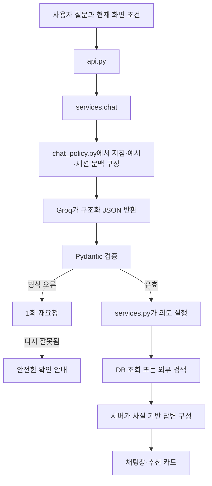

# 초보자를 위한 LunchRun 챗봇 가드레일 설정·수정 가이드 v1

- 작성일: 2026-11-10
- 대상: 챗봇이 질문을 어떻게 이해하고 실행하는지 직접 확인·수정하려는 개발자
- 기준: 현재 `app/chat_policy.py`, Groq 클라이언트와 DB 추천 서비스
- 이 문서의 개선 예시는 수정 방법 설명입니다. 새 의도나 프롬프트를 실제 코드에 적용한 것은 아닙니다.

> [기존 CHAT_POLICY_GUIDE.md](docs_old/CHAT_POLICY_GUIDE.md)는 이전 구조를 설명해 `docs_old`에 보관했습니다. 그 문서의 `system.txt`, `examples.json`, `replies.json`, `services.MENUS` 안내를 현재 코드에 그대로 적용하지 마세요. 현재 적용 파일은 아래 3절에서 확인할 수 있습니다.

## 1. 가드레일이란 무엇인가요?

가드레일은 챗봇이 **어떤 질문을 어떻게 해석하고, 어디까지 실행해도 되는지 정하는 규칙**입니다.

LunchRun에서는 AI가 사용자에게 보낼 추천 문장을 전부 작성하지 않습니다. Groq가 “식당 검색 요청이다”, “예산 변경이다” 같은 실행 계획을 JSON으로 반환하면, Python 서버가 이를 검사하고 DB 조회나 검색을 실행합니다.

따라서 가드레일은 한 파일에 들어 있지 않습니다.

| 층 | 역할 | 쉬운 예 |
|---|---|---|
| 프롬프트 | 질문을 어떻게 이해할지 설명 | “다른 거 먹을래”는 재추천 요청 |
| 예시 | 질문과 기대 해석을 보여줌 | 질문 → `reroll_menu` |
| Pydantic 계약 | 허용하는 의도·값·조합 검사 | 모르는 메뉴 ID 거부 |
| 서버 실행 | 검증된 의도대로 실제 작업 | 메뉴 후보 조회·카카오 검색 |
| 응답 문구·화면 | 검증 결과를 사용자에게 전달 | 가격 확인 불가, 조건 적용 버튼 |

프롬프트는 AI 해석을 유도합니다. Pydantic은 형식과 허용값을 검사합니다. 예를 들어 짬뽕 ID가 정상적인 ID라는 검사는 가능하지만, 사용자가 김치찌개를 원했는데 짬뽕으로 해석한 의미 오류까지 자동으로 잡아주지는 않습니다.

## 2. 사용자 질문이 답변이 되기까지



오류가 보이면 “프롬프트 문제”라고 바로 결론내리지 말고 해석 결과, 서버 실행, DB 근거와 화면 상태를 순서대로 확인합니다.

## 3. 현재 실제로 읽는 파일

실행 파일을 결정하는 기준은 [app/chat_policy.py](app/chat_policy.py)의 세 경로 상수입니다.

| 상수 | 현재 파일 | 바꾸는 내용 |
|---|---|---|
| `SYSTEM_PROMPT_FILE` | [system_v2.txt](app/prompts/system_v2.txt) | 역할, 의도 설명, 우선순위, 금지사항 |
| `EXAMPLES_FILE` | [examples_v2.json](app/prompts/examples_v2.json) | 질문과 정답 해석 예시 |
| `REPLIES_FILE` | [replies_v3.json](app/prompts/replies_v3.json) | 서버의 확인·지원 범위 안내문 |

이전 파일이 폴더에 있어도 경로 상수가 가리키지 않으면 현재 요청에는 적용되지 않습니다. 새 `system_v3.txt`를 만들기만 해서는 바뀌지 않습니다.

## 4. 원하는 변경에 따라 어디를 수정하나요?

| 원하는 변경 | 우선 볼 파일 | 함께 확인할 곳 |
|---|---|---|
| “다른 거” 같은 표현 해석 개선 | 시스템 지침·해석 예시 | 가드레일·실제 Groq 테스트 |
| 반경 확인 문구 수정 | `replies_v3.json` | `load_replies()`의 허용 키·길이 |
| 새 의도 추가 | `chat_policy.py` | 지침, 예시, `services.chat()`, 세션, 테스트 |
| 메뉴 추천 답변의 표현 수정 | `services.py` | 화면 렌더링 |
| 식당 가격·영업 답변 수정 | `_restaurant_detail_answer()` | DB 상태와 영업 계산 |
| 반경·예산 허용 범위 변경 | `schemas.py`, `ConditionPatch` | 클라이언트 검증·메뉴 서비스·화면·지침·테스트 |
| 메뉴 추가 | DB `menu_catalog`, `menu_alias` | 멱등 시드와 후보 매칭 |
| 대화 기억 범위 변경 | `chat_sessions.py`, `chat_policy.py` | 전달 길이·세션 복원·테스트 |
| Groq 모델·시간 제한 변경 | `.env`, `config.py` | 클라이언트 요청 옵션과 실제 모델 검사 |

특히 실제 가격·영업 여부 답변은 `replies` 문구만 바꿔서 해결하지 않습니다. 현재 서버의 DB 답변 함수가 만드는 문장을 확인해야 합니다.

## 5. 구조화 응답의 각 항목 이해하기

아래는 “예산 9천 원으로 바꿔줘”의 해석 예시입니다.

```json
{
  "intent": "change_conditions",
  "condition_patch": {"budget": 9000},
  "search_after_change": false
}
```

| 항목 | 의미 | 사용 규칙 |
|---|---|---|
| `intent` | 무엇을 할지 | 서버가 허용한 의도 중 하나 |
| `menu_id` | 대상으로 삼을 대표 메뉴 ID | 현재 활성 카탈로그의 ID만 허용 |
| `restaurant_id` | 후속 질문 대상 식당 | 현재 세션 추천·후보 목록 ID만 허용 |
| `requested_detail` | 식당의 어떤 정보를 물었는지 | `price`, `hours`, `address`, `menu`, `reason` |
| `condition_patch` | 변경할 조건만 담은 객체 | `change_conditions`일 때 비어 있지 않아야 함 |
| `search_after_change` | 조건 변경 뒤 검색까지 요청했는지 | `change_conditions`에서만 `true` 가능 |
| `clarification_kind` | 추가 확인 안내의 종류 | `clarify`일 때만 사용 |
| `clarification` | 모델의 확인 문장 필드 | 현재 화면에는 모델 원문 대신 서버 안내를 사용 |

이 키는 Python 예약어가 아니라 프로젝트에서 정한 이름입니다. 하지만 이제 프롬프트·스키마·실행 코드가 함께 사용하므로 이름을 바꾸려면 참조하는 곳도 모두 변경해야 합니다.

### 현재 허용 의도

| 의도 | 의미 | 현재 실행 |
|---|---|---|
| `recommend_menu` | 메뉴 추천 | 조건 후보에서 랜덤 메뉴 선정 |
| `reroll_menu` | 메뉴 재추천 | 현재·최근 메뉴를 제외하고 선정 |
| `search_restaurants` | 식당 검색 | 명시 메뉴 또는 현재 메뉴로 검색, 없으면 메뉴부터 선정 |
| `ask_menu_detail` | 대표 메뉴 설명 | DB 카탈로그 설명 |
| `ask_restaurant_detail` | 최근 식당 상세질문 | DB 가격·주소·영업정보 등 조회 |
| `change_conditions` | 조건 변경 | 화면에 변경안 반환 |
| `clarify` | 입력 또는 대상 확인 | 안전 안내와 필요한 pending 저장 |
| `out_of_scope` | 서비스 범위 밖 | 정해진 범위 안내 |

`explain_menu`도 호환용으로 스키마에 남아 있지만 현재 프롬프트는 `ask_menu_detail`을 사용합니다. 새 기능을 추가할 때 과거 의도를 무작정 복제하지 마세요.

## 6. 문구만 바꾸는 가장 작은 수정

예를 들어 반경 확인 안내를 더 쉽게 바꾸려면 현재 `replies_v3.json`의 `radius`에 해당하는 **문자열 값**을 바꿉니다.

예시 문구: “몇 m 범위로 찾아볼까요? 현재는 50~500m 사이에서 설정할 수 있어요.”

현재 `load_replies()`는 다음을 검사합니다.

- 정해진 키가 모두 존재하고 불필요한 추가 키가 없는가?
- 모든 값이 문자열인가?
- 공백뿐인 문장이 아닌가?
- 문자열 길이가 500자를 넘지 않는가?

문구만 바꿀 때는 `radius`를 임의로 `distance`로 바꾸지 않습니다. 새 확인 유형이 필요하다면 `clarification_kind` 허용값, 안내문의 필수 키, 서비스의 분기와 필요 시 `PendingAction`까지 연결해야 합니다.

JSON 파일에는 주석과 마지막 쉼표를 넣지 않습니다. `true`/`false`/`null`은 소문자로 쓰며, Python의 `True`/`False`/`None`과 구분합니다.

## 7. 기존 의도를 더 잘 알아듣게 만드는 수정

새 기능 없이 “좀 싼 걸로”를 예산 확인으로 해석하게 하고 싶다면 다음 순서로 작업합니다.

1. 시스템 지침에 “구체적인 금액이 없는 저렴한 메뉴 요청은 원하는 예산을 확인한다”는 규칙을 추가합니다.
2. 예시 파일에 질문과 기대 응답을 추가합니다.
3. 서버가 `budget` 확인 유형을 이미 처리하는지 확인합니다.
4. JSON·계약 검사 후 실제 질문으로 확인합니다.

예시 파일에 추가할 객체의 형태:

```json
{
  "question": "좀 싼 걸로 해줘",
  "expected": {
    "intent": "clarify",
    "condition_patch": {},
    "clarification_kind": "budget"
  }
}
```

전체 파일은 이런 객체들이 들어 있는 JSON 배열입니다. 기존 배열 안에 추가하고 앞뒤 쉼표를 확인하세요.

`expected`는 학습 예시의 정답이지 서버를 실행하는 명령이 아닙니다. 예시를 추가해도 Python 분기가 자동 생성되지 않습니다. 기본 예시 테스트도 JSON 계약을 확인할 뿐 Groq가 실제로 같은 해석을 하는지는 검사하지 않습니다.

## 8. 실전 사례: “김치찌개 먹고 싶어”가 짬뽕으로 나오는 문제

### 8.1 현재 가능한 원인

현재 일반 추천과 재추천에서는 `menu_id`를 허용하지 않습니다. “김치찌개 먹고 싶어”가 `recommend_menu`로 해석되면 대상 메뉴가 빠지고 서버가 후보에서 임의로 추첨할 수 있습니다.

이것은 코드로 확인되는 가능한 경로입니다. 특정 실행의 실제 해석 결과를 확보하지 않았다면 그 요청이 반드시 이 경로였다고 단정하지는 않습니다.

### 8.2 코드를 바꾸기 전에 결정할 것

다음처럼 기대 동작을 먼저 정하면 수정할 범위가 명확해집니다.

| 질문 | 권장 해석 예 | 원하는 실행 |
|---|---|---|
| 김치찌개 먹고 싶어 | 새 `select_menu`, `menu_id=kimchi` | 김치찌개 선택, 조건 표시 |
| 김치찌개 식당 찾아줘 | `search_restaurants`, `menu_id=kimchi` | 지정 메뉴 식당 검색 |
| 아무거나 골라줘 | `recommend_menu` | 랜덤 추천 |
| 김치찌개 말고 다른 거 | `reroll_menu`와 명시 제외 처리 설계 | 김치찌개를 제외 |
| 김치찌개가 뭐야? | `ask_menu_detail`, `menu_id=kimchi` | 메뉴 설명 |

`select_menu`는 이 문서에서 제안하는 새 의도이며 현재 구현되어 있지 않습니다. 특히 “김치찌개 말고”처럼 부정한 메뉴를 선택 메뉴로 인식하지 않도록 별도 사례가 필요합니다.

### 8.3 실제 수정이 필요한 위치

1. **지침**: 새 `select_menu`의 의미와 메뉴 이름을 명시한 요청의 우선순위를 정의합니다.
2. **예시**: 선택·검색·설명·부정·모호한 문장을 각각 추가합니다.
3. **스키마**: `intent` Literal과 메뉴 ID 허용 의도 집합에 `select_menu`를 추가합니다.
4. **필수값 검증**: `select_menu`에 `menu_id`가 없으면 거부하도록 합니다.
5. **실행**: 지정 메뉴를 선택하고 식당 검색 여부를 명확히 지정합니다.
6. **후보 확인**: 활성 카탈로그와 현재 조건, 실제 근거 우선 정책으로 지정 메뉴가 배제되는 경우를 구분합니다.
7. **세션**: 새 선택 메뉴가 기록되고 이전 식당 문맥이 어떻게 정리되는지 확인합니다.
8. **화면·테스트**: 메뉴와 적용 조건이 표시되고 지정 메뉴가 바뀌지 않는지 확인합니다.

현재 공통 추천 분기는 `parsed.menu_id`를 `recommend()`에 전달하고 `search_restaurants` 의도에서만 식당 검색을 켭니다. 이 경로를 재사용할 수 있는지 확인하되, 의도 목록만 추가하고 실행 의미를 확인하지 않은 채 완료했다고 판단하지 마세요.

조건에 맞지 않거나 후보에 없는 지정 메뉴를 `None`으로 바꿔 넘기면 랜덤 추첨이 실행될 수 있습니다. 사용자가 지정한 메뉴는 실패 이유를 안내하고, 다른 메뉴로 바꿀지는 사용자 정책에 따라 결정하세요.

### 8.4 완료 기준

- 김치찌개를 명시하면 김치찌개가 선택되는가?
- 예산이나 음식 종류가 충돌하면 다른 메뉴로 대체하지 않고 설명하는가?
- 메뉴 선택만 요청했을 때 외부 식당 검색을 실행하지 않는가?
- 이어서 “이 메뉴 식당 보여줘”라고 하면 같은 메뉴를 사용하는가?
- 모르는 메뉴, 여러 메뉴, 메뉴 부정 표현을 안전하게 처리하는가?

## 9. 조건 범위를 바꾸는 수정

예를 들어 검색 반경을 500m보다 늘리려면 프롬프트 숫자만 바꾸면 안 됩니다. 현재 여러 곳에서 같은 범위를 검사합니다.

확인할 파일:

- `app/prompts/`: 지침·예시·반경 안내
- `app/chat_policy.py`: `ConditionPatch.radius_m`
- `app/schemas.py`: 요청의 `radius_m`
- `app/clients/groq.py`: Groq 요청 전 반경 검사
- `app/clients/kakao.py`: 식당 검색 요청 범위 검사
- `app/menu_catalog.py`: 후보 서비스 조건 검사
- `app/chat_sessions.py`: 저장 상태 반경 검사
- `frontend/app.js`: 반경 입력·변경안 적용 검사
- `tests/`: 범위 경계값 검사

외부 API의 허용 범위도 별도로 확인해야 합니다. 범위를 정한 뒤 정상값·최솟값·최댓값·범위 밖 값이 모두 일관되게 처리되는지 검증합니다.

`diet`, `spicy`, `minutes`가 응답 계약에 있다는 이유만으로 실제 매장 검증이 구현된 것은 아닙니다. 필드를 허용하는 것과 실제 추천 필터로 보장하는 것은 구분하세요.

## 10. 대화 문맥과 pending 이해하기

현재 해석 입력에는 질문 외에 최근 10턴, 현재 조건과 반경, 선택 메뉴, 최근 식당 ID·이름, `pending_action`이 들어갑니다. 원시 위치 좌표와 식당 상세 객체는 별도 필드로 전달하지 않습니다. 다만 이전 질문·답변 문자열 안에 언급된 사실까지 제거하는 구조는 아니므로 문맥에 사실 정보가 절대로 없다고 이해하면 안 됩니다.

예를 들어 다음 대화에서는 두 번째 질문만으로도 반경 변경임을 이해해야 합니다.

```text
사용자: 반경을 줄여줘
서버: 몇 m로 바꿀까요?
사용자: 300m
```

첫 질문에서 서버가 `pending_action.kind=change_radius`와 현재 반경 등을 저장하고, 다음 Groq 해석에 함께 전달합니다.

문맥이 이상하면 같은 브라우저의 `/api/chat/session`에서 `selected_menu`, `restaurant_ids`, `candidate_restaurant_ids`, `pending_action`을 확인하세요. 서버를 재시작하면 메모리 세션이 없어집니다.

새 pending 유형을 만들 때는 `PendingAction.kind`의 Literal과 저장할 필드, 기록·해제 시점, 다음 입력의 해석 규칙을 함께 설계해야 합니다.

## 11. 버전을 나누어 적용하는 순서

기존 파일은 보존하고 변경하는 종류의 파일만 새 버전을 만듭니다.

예를 들어 지침과 예시를 바꾸는 경우:

1. `system_v2.txt`를 참고해 `system_v3.txt`를 작성합니다.
2. `examples_v2.json`을 참고해 `examples_v3.json`을 작성합니다.
3. `chat_policy.py`에서 `SYSTEM_PROMPT_FILE`, `EXAMPLES_FILE`을 새 경로로 바꿉니다.
4. 안내 문구를 바꾸지 않았다면 `REPLIES_FILE`은 기존 `replies_v3.json`을 유지합니다.
5. 테스트에서 파일명에 대한 기대값도 변경 의도에 맞게 갱신합니다.
6. 변경 이유·재현 문장·검증 결과를 새 버전 문서에 기록합니다.

현재 `tests/test_chat_policy_v2.py`는 `system_v2.txt`와 `replies_v3.json`이라는 파일명을 직접 검사합니다. 버전을 바꾼 뒤 이 검사만 실패한다면 새 버전 적용이 의도한 변경인지 확인한 후 기대값을 갱신하세요. 기능 검증 자체를 삭제해서 통과시키지는 않습니다.

현재 경로가 유지된 상태에서 프롬프트·예시·안내문 내용은 요청마다 다시 읽습니다. Python 경로 상수나 `.env`를 바꿨다면 서버 재시작이 필요합니다. 여러 파일의 계약을 바꿀 때는 수정이 끝난 뒤 서버를 다시 실행해 버전이 섞이지 않게 확인하는 것이 좋습니다.

## 12. Groq 설정은 어디서 하나요?

`.env`에서 다음 값을 설정하고 서버를 다시 시작합니다.

| 변수 | 현재 기본값 | 조정 목적 |
|---|---|---|
| `GROQ_API_KEY` | 빈 값 | Groq 인증, 서버에만 보관 |
| `GROQ_MODEL` | `openai/gpt-oss-20b` | 계정에서 사용 가능한 모델 지정 |
| `GROQ_TIMEOUT_SECONDS` | `30` | 두 차례 형식 요청을 포함한 전체 Groq 제한시간 |
| `GROQ_MAX_COMPLETION_TOKENS` | `1024` | 구조화 출력 한도 |

현재 클라이언트는 JSON 응답 모드와 `temperature=0`을 사용합니다. 모델별 옵션은 `app/clients/groq.py`에 있습니다. 모델명을 바꿨다면 해당 옵션 지원 여부와 해석 품질을 실제로 확인해야 합니다.

토큰은 글자 수와 다릅니다. 토큰을 늘리는 것만으로 의도 누락이나 잘못된 서버 분기가 해결되지는 않습니다. 먼저 지침·스키마·실행의 연결을 확인하세요.

## 13. 수정 후 검증 순서

### A. JSON 문법 확인

현재 파일을 확인하는 명령입니다. 새 버전을 만들었다면 파일명을 바꾸세요.

```powershell
cd C:\TeamProject_1
.\.venv\Scripts\python.exe -m json.tool app\prompts\examples_v2.json
.\.venv\Scripts\python.exe -m json.tool app\prompts\replies_v3.json
```

이 검사는 JSON 문법만 확인합니다. 의도와 필드 조합이 맞는지는 다음 검사에서 확인합니다.

### B. 해석 계약과 서비스 실행 검사

```powershell
.\.venv\Scripts\python.exe -m pytest tests\test_chat_policy.py tests\test_chat_policy_v2.py tests\test_groq_context.py tests\test_groq_client.py tests\test_recommendations.py -v
```

| 테스트 | 확인하는 내용 |
|---|---|
| `test_chat_policy.py`, `test_chat_policy_v2.py` | 허용 의도·필드·ID와 예시 계약 |
| `test_groq_context.py` | 최근 문맥 전달과 형식 재요청 |
| `test_groq_client.py` | Groq 응답 파싱·안전 오류 |
| `test_recommendations.py` | 검증된 해석을 실제 서비스가 어떻게 실행하는지 |

현재 단위 테스트의 메뉴 입력 일부는 DB 시드 원본으로 만듭니다. 새 운영 DB 메뉴만 추가한 경우 테스트 입력도 해당 메뉴를 포함하는지 확인해야 합니다.

### C. 실제 Groq 해석 확인

아래 검사는 실제 사용량이 발생합니다.

```powershell
$env:LUNCHRUN_LIVE_GROQ = "1"
.\.venv\Scripts\python.exe -m pytest tests\test_guardrail_live.py::LiveGuardrailTests -v
Remove-Item Env:LUNCHRUN_LIVE_GROQ
```

기존 실제 테스트의 세 문장은 반경 범위 밖 요청, 알레르기 요청, 비밀 공개 요청입니다. 이 명령만 실행한다고 새 김치찌개 사례가 자동으로 검증되지는 않습니다. 새 기능의 대표 문장을 실제 테스트 사례에도 추가해야 합니다.

### D. 브라우저 확인

1. 위치와 조건을 고정합니다.
2. 재현 문장을 입력합니다.
3. Network의 `/api/chat/stream` Payload에서 질문·조건·menu_id를 확인합니다.
4. `completed.data.result.menu`와 최종 답변을 확인합니다.
5. 이어서 후속 질문을 보내 현재 메뉴가 유지되는지 확인합니다.

현재 스트림은 원시 Groq 해석 JSON을 브라우저에 공개하지 않습니다. Payload는 화면이 보낸 요청이며 모델의 해석 결과가 아닙니다. 원인을 더 좁히려면 서비스 테스트에서 해석을 주입하거나, 필요한 의도·ID만 임시 진단으로 확인하고 질문·프롬프트·키 전체를 로그에 남기지 마세요.

## 14. 잘못됐을 때 어디부터 보나요?

| 증상 | 먼저 확인할 곳 |
|---|---|
| 파일을 고쳤는데 반영 안 됨 | 경로 상수가 가리키는 버전과 실행 서버 경로 |
| 지침 파일 확인 오류 | 파일 존재·인코딩·예시 JSON 문법 |
| 확인 안내만 반복 | 스키마에 새 의도가 있는지, 필수값과 허용 ID가 맞는지 |
| 김치찌개를 원했는데 다른 메뉴 | 명시 메뉴 의도 유무, menu_id 전달, 후보 조회 정책 |
| 조건 변경이 바로 적용되지 않음 | 현재 `suggested_patch`와 화면 적용 버튼 흐름 |
| “거기”의 대상이 다름 | 최근 식당 목록과 pending, 선택 상태 |
| 가격·영업 상태가 잘못됨 | DB 메뉴·수집 상태·영업 구간과 서버 답변 함수 |
| Groq 연결 표시는 정상인데 채팅 실패 | 모델 목록 확인과 생성 요청의 차이, 오류 코드 |
| `groq_truncated` | 출력 잘림과 토큰 한도 |
| `groq_rate_limit` | 외부 Groq 사용량 제한 |
| `chat_rate_limit` | 프로젝트의 세션별 채팅 제한 |

현재 JSON·스키마 오류는 1회 재요청한 후 안전한 `clarify`로 전환합니다. 인증·사용량 제한·통신 오류·시간 초과·토큰 잘림은 이 형식 재시도 경로에 들어가지 않습니다.

## 15. 변경 기록 양식

| 항목 | 작성 예 |
|---|---|
| 바꾸려는 기능 | 명시 메뉴 선택 |
| 재현 문장 | 김치찌개 먹고 싶어 |
| 현재 문제 | 랜덤 추천으로 다른 메뉴가 나옴 |
| 기대 의도·대상 | 제안: select_menu / kimchi |
| 외부 검색 여부 | 선택만 할 때는 검색하지 않음 |
| 충돌 정책 | 예산·음식 종류 충돌 시 사용자 확인 |
| 새 지침·예시 파일 | 실제 적용한 버전명 |
| 스키마·서비스 변경 | 필수 필드와 실행 분기 |
| 자동 검증 | 테스트명과 결과 |
| 실제 문장 검증 | 조건과 실제 응답 |
| 되돌릴 기준 | 실패 시 돌아갈 코드·파일 버전 |

먼저 재현 문장과 기대 동작을 적고, 기존 의도로 해결되는지 판단하세요. 새 의도가 필요할 때만 계약과 실행을 함께 늘리면 변경 범위를 이해하고 관리하기 쉽습니다.

함께 읽기: [프로젝트 README](README.md), [백엔드·DB 점검 가이드](BACKEND_DB_GUIDE.md).
