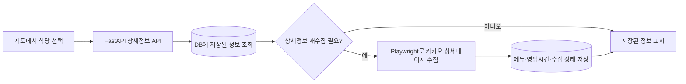

# LUNCH RUN — 카카오 지도와 Supabase DB 연동

`aio-04-p1-team4` 저장소의 `kjw-map` 브랜치에서 작업한 식당 탐색 화면과 DB 연동 소스를 설명합니다. 현재 위치나 검색한 장소를 기준으로 점심 식당을 찾고, 메뉴·가격·영업시간과 길찾기를 확인하는 프로젝트입니다.

| 구성 | 역할 | 실행 방식 |
| --- | --- | --- |
| `화면구현_파일` | 지도 UI와 식당·메뉴 데이터 스냅샷 | Python 표준 라이브러리로 실행하는 화면 데모 |
| `supabaseDB` | 식당·메뉴·영업시간 저장·조회와 상세 수집 | FastAPI와 Supabase PostgreSQL을 연결하는 서버 |

이 문서에 두 폴더의 기능, 기술 구성, 설정, 실행 방법과 주요 파일을 함께 정리했습니다. 각 실행 절차의 작업 폴더를 확인하세요.

## 화면 구현

`kjw-map` 브랜치의 카카오 지도 기반 식당 탐색 화면입니다. 현재 위치나 검색한 장소를 기준으로 식당을 찾고, 메뉴·가격·영업시간을 확인하거나 룰렛으로 점심 식당을 고를 수 있습니다.

`화면구현_파일` 폴더는 **HTML·CSS·JavaScript 화면과 Python 개발 서버로 구성된 독립 실행 데모**입니다. 포함된 식당·메뉴 자료는 수집 시점의 스냅샷이며, Supabase DB에서 실시간으로 읽는 구성과는 구분됩니다.

### 주요 기능

- **지도와 식당 목록**: 카카오 지도, 식당 핀, 목록과 선택한 식당 정보창을 함께 표시합니다.
- **기준 위치 설정**: 현재 위치를 확인하거나 장소를 검색해 탐색 기준점을 정합니다.
- **주변 식당 탐색**: 검색 기준점 주변의 식당을 찾고 음식 분류에 따라 살펴봅니다.
- **랜덤 선택**: 룰렛으로 식당을 고릅니다.
- **메뉴 확인**: 식당별 메뉴·가격과 금천구 메뉴 검색 화면을 제공합니다.
- **영업시간 표시**: 준비된 영업시간 자료를 바탕으로 식당 정보를 표시합니다.
- **길찾기**: 출발지를 선택하고 카카오맵 길찾기로 이동합니다. 서버 도보 경로 조회 코드도 포함합니다.
- **겹친 핀 처리**: 가까운 위치의 식당을 구분해 선택할 수 있도록 핀 겹침을 처리합니다.

화면 데모에 포함된 식당·메뉴·영업시간은 수집 시점의 스냅샷입니다. 모든 정보가 실시간으로 갱신되는 것은 아니며, 실제 방문 전에는 매장 정보를 확인해야 합니다.

### 기술 구성

| 영역 | 기술 |
| --- | --- |
| 화면 | HTML, CSS, JavaScript |
| 지도·장소 검색 | Kakao Maps JavaScript SDK |
| 개발 서버 | Python 3 표준 라이브러리 `http.server` |
| 데이터 | JavaScript 파일에 포함된 식당·메뉴·분류·영업시간 스냅샷 |

### 지도 화면 실행

Windows PowerShell 기준입니다. Python 3와 Git이 필요하며, 화면 데모에는 별도의 Python 패키지 설치나 npm 빌드가 필요하지 않습니다.

#### 1. 브랜치 내려받기

```powershell
git clone --branch kjw-map --single-branch https://github.com/encore-ai-campus/aio-04-p1-team4.git
cd aio-04-p1-team4
cd 화면구현_파일
```

#### 2. 카카오 키 설정

처음 실행할 때 `.env.example`을 `.env`로 복사하고 실제 키를 입력합니다. 기존 `.env`가 있으면 필요한 항목만 수정하세요.

```powershell
Copy-Item .env.example .env
```

```dotenv
KAKAO_JAVASCRIPT_KEY=your_kakao_javascript_key
KAKAO_REST_API_KEY=your_kakao_rest_api_key
```

| 설정 | 용도 |
| --- | --- |
| `KAKAO_JAVASCRIPT_KEY` | 브라우저에서 실제 지도와 장소 검색을 사용 |
| `KAKAO_REST_API_KEY` | 서버의 도보 경로 조회 코드에서 사용 |

카카오 JavaScript SDK의 허용 도메인에 실행 주소 `http://localhost:5500`을 등록합니다. `127.0.0.1`로 접속하려면 해당 주소와 포트도 설정에 맞춰 등록하세요. JavaScript 키와 REST API 키는 서로 다릅니다.

도보 경로 조회는 외부 API의 제공 여부와 계정 권한에 따라 실패할 수 있습니다. 코드가 포함되어 있다는 사실만으로 실제 경로 API 사용이 보장되지는 않습니다. 연결이 안 되면 화면의 카카오맵 길찾기를 이용하세요.

#### 3. 개발 서버 실행

`start_site.cmd`를 실행하거나 다음 명령을 사용합니다.

```powershell
python examples/kakao-map/serve.py
```

- 지도 화면: [http://localhost:5500/](http://localhost:5500/)
- 전체 메뉴 검색: [http://localhost:5500/menu-catalog.html](http://localhost:5500/menu-catalog.html)
- 서버 종료: 실행한 터미널에서 `Ctrl+C`

5500 포트가 사용 중이면 해당 포트의 기존 서버를 종료한 후 실행합니다. HTML 파일을 직접 열거나 일반 정적 서버만 사용하면 설정 조회와 서버 도보 경로 기능을 정상적으로 사용할 수 없습니다.

### 주요 파일

아래 경로는 "화면구현_파일/"을 기준으로 합니다.

| 파일 | 역할 |
| --- | --- |
| `examples/kakao-map/index.html` | 지도·식당 목록·정보창 화면 |
| `examples/kakao-map/app.js` | 지도, 검색, 룰렛과 식당 선택 동작 |
| `examples/kakao-map/styles.css` | 공통 화면 디자인 |
| `examples/kakao-map/menu-catalog.html` | 전체 메뉴 검색 화면 |
| `examples/kakao-map/menu-catalog.js` | 메뉴 검색과 결과 표시 |
| `examples/kakao-map/location.js` | 현재 위치 확인과 위치 진단 |
| `examples/kakao-map/nearby-search.js` | 주변 식당 검색 |
| `examples/kakao-map/business-hours.js` | 영업시간 처리 |
| `examples/kakao-map/pin-overlaps.js` | 겹친 지도 핀 처리 |
| `examples/kakao-map/routes.js` | 길찾기 링크와 경로 표시 보조 |
| `examples/kakao-map/serve.py` | 정적 파일·설정·도보 경로 요청을 제공하는 개발 서버 |
| `examples/kakao-map/walk_routes.py` | 서버에서 외부 도보 경로 조회 |
| `start_site.cmd` | Windows 실행 진입점 |

### 데이터와 설정

- 메뉴·가격·영업시간은 매장 상황에 따라 달라질 수 있습니다.
- 위치 권한과 지도 SDK 설정에 따라 현재 위치·장소 검색 사용 여부가 달라집니다.
- 실제 `.env`와 REST API 키는 저장소에 올리지 않습니다.
- 도보 경로 조회 실패 시 카카오맵 길찾기를 이용할 수 있습니다.

## Supabase·DB 연동

`supabaseDB` 폴더는 지도 화면, FastAPI 서버, SQLAlchemy 모델과 마이그레이션을 포함합니다.
저장소 루트의 `start_site.cmd`도 이 지도·DB 서버를 실행합니다.

### 설치와 실행

아래 절차는 저장소 루트에서 "cd supabaseDB"로 이동한 뒤 진행합니다. 명령과 파일 경로는 "supabaseDB/" 기준입니다.

> 초기 업로드 커밋 "b900b6f"에는 공통 모듈과 실행 파일 일부가 빠져 있습니다. 설치 절차는 "setup.cmd", "start_site.ps1" 및 공통 모듈을 보완한 로컬 통합본을 기준으로 합니다. 원본 업로드본의 누락 항목은 아래 '업로드본과 로컬 통합본의 차이'를 확인하세요.

1. `setup.cmd`를 실행합니다. Python 3과 `py` 실행기가 필요합니다.
2. `.env.example`을 `.env`로 복사하고 `SUPABASE_DB_URL`, `KAKAO_JAVASCRIPT_KEY`를 입력합니다.
3. 저장소 루트 또는 이 폴더의 `start_site.cmd`를 실행합니다.
4. 지도: http://127.0.0.1:8000/map (5500 포트에서도 `/map`으로 제공)
5. 기존 메인 화면: http://127.0.0.1:8000/ (`frontend`의 정적 화면)

이미 의존성이 설치된 Python이 있으면 PowerShell에서 다음과 같이 실행할 수 있습니다.
Git worktree에서는 원본 체크아웃의 `.venv`도 자동으로 찾아 사용합니다.

```powershell
$env:LUNCHRUN_PYTHON='C:\path\to\.venv\Scripts\python.exe'
.\start_site.cmd
```

Supabase의 **Connect → Session pooler** PostgreSQL 연결 주소를 사용합니다.
URL의 비밀번호 특수문자는 URL 인코딩하며, 연결 문자열과 키는 Git에 올리지 않습니다.
브라우저에는 지도용 JavaScript 키만 전달하고 DB 연결 문자열과 REST 키는 전달하지 않습니다.
JavaScript 키의 허용 도메인에 사용하는 localhost 또는 127.0.0.1 주소와 포트를 등록합니다.

### 연결 확인

`khj_backend` 폴더에서 실행합니다.

```powershell
.\.venv-db\Scripts\python.exe supabase_manage.py check
.\.venv-db\Scripts\python.exe check_map_connection.py
.\.venv-db\Scripts\python.exe -m pytest tests -q
```

`check`는 연결, 테이블별 행 수와 RLS 설정을 읽기 전용으로 확인합니다.
서버는 기존 Supabase 스키마의 필수 컬럼을 확인하며 자동 초기화·삭제·마이그레이션을 하지 않습니다.
이 브랜치와 다른 스키마가 연결되면 시작 시 호환성 오류로 중단하므로 기존 데이터를 임의 변환하지 않습니다.
완전히 새 DB를 구축할 때만 스키마 계획을 검토한 후 `supabase_manage.py init`을 별도 실행합니다.

### 지도와 DB의 동작

- 장소 검색은 기존 카카오 지도 SDK를 사용합니다.
- 식당 핀 선택 시 DB에 저장된 메뉴·영업시간을 먼저 표시합니다.
- 미수집·오래된 자료는 카카오 상세페이지를 확인한 뒤 DB에 저장합니다. 수집에는 Chromium이 필요합니다.
- 동일 카카오 ID는 갱신하고, 수집 실패 시 기존 메뉴·시간을 보존합니다.
- 현재 API는 `basic_source=kakao_api`인 식당과 출처가 일치하는 상세정보를 표시합니다.
- DB 드라이버는 TLS 검증을 사용하는 `pg8000`이며 psycopg DLL에 의존하지 않습니다.

주요 경로: `khj_backend/app/map_api.py`, `khj_backend/app/database/session.py`,
`khj_backend/app/database/connection.py`, `examples/kakao-map/db-details.js`.

주요 API: `GET /api/health`, `GET /api/restaurants`, `GET /api/restaurants/{id}`,
`GET /api/menu-catalog`, `POST /api/restaurants/{id}/details`.

### 연동 구조와 API

`supabaseDB`는 카카오 장소의 기본정보와 상세페이지에서 수집한 메뉴·영업시간을 DB에 저장하고 지도에서 다시 조회하는 작업을 담고 있습니다.



#### 주요 처리

- 카카오 장소 ID를 기준으로 식당을 저장하고 갱신합니다.
- 식당 기본정보의 출처를 `basic_source=kakao_api`로 구분합니다.
- 메뉴·영업시간의 출처 URL과 확인 시각을 기록합니다.
- 수집 출처가 현재 식당의 `place_url`과 일치하는 상세정보를 반환합니다.
- 정상 수집 결과는 캐시로 재사용하고, 실패한 수집은 재시도 간격을 둡니다.
- 상세 수집 실패 시 기존 메뉴·영업시간을 보존합니다.
- Supabase 연결 확인, 초기 구성, SQLite 자료 복사 등을 위한 관리 코드를 포함합니다.

#### 주요 API

아래 경로는 `khj_backend/app/map_api.py`에 구현된 API입니다. 위 설치 안내에 따라 공통 파일과 DB 연결을 준비한 환경에서 사용합니다.

| 메서드 | 경로 | 설명 |
| --- | --- | --- |
| GET | `/api/health` | 서버 상태와 DB 종류 확인 |
| GET | `/api/restaurants` | 카카오 API 출처의 식당 목록 조회 |
| GET | `/api/restaurants/{rid}` | 식당의 저장된 메뉴·영업시간·수집 상태 조회 |
| POST | `/api/restaurants/{rid}/details` | 식당 기본정보 저장 및 필요 시 상세 수집 |
| GET | `/api/menu-catalog` | 저장된 식당별 메뉴와 집계 정보 조회 |
| POST | `/api/walking-route` | 서버를 통한 도보 경로 조회 |

#### 데이터 모델

| 테이블 | 내용 |
| --- | --- |
| `restaurant` | 카카오 장소 ID, 식당명, 좌표, 주소, 장소 URL과 기본정보 출처 |
| `menu` | 식당별 메뉴명, 가격, 가격 확인 상태 |
| `business_hours` | 요일별 영업 구간, 휴무, 익일 종료, 라스트오더 |
| `place_detail_status` | 메뉴·영업시간 수집 상태, 출처 URL, 확인·시도 시각 |
| `menu_catalog` | 대표 메뉴 카탈로그 |
| `menu_alias` | 대표 메뉴의 별칭 |

### 업로드본과 로컬 통합본의 차이

GitHub에 처음 올라간 `b900b6f` 소스 묶음은 그날 변경한 파일 위주로 구성되어, 공통 모듈·과거 마이그레이션·일부 정적 파일이 빠져 있습니다. 해당 커밋만 내려받았다면 이 문서의 설치 절차 전에 누락된 공통 파일을 함께 준비해야 합니다. 예: `app.repositories.restaurants`, `app.database.seed`, `alembic.ini`.

현재 로컬 통합 작업에는 `setup.cmd`, `start_site.ps1`, `.env.example` 및 공통 모듈을 보완한 구성이 있습니다. 위의 설치·연결 확인 절차는 이 파일들이 포함된 구성을 기준으로 합니다.

### 기술 구성

| 영역 | 기술과 역할 |
| --- | --- |
| 지도 화면 | HTML, CSS, JavaScript, Kakao Maps JavaScript SDK |
| API 서버 | Python, FastAPI, Uvicorn |
| DB | Supabase PostgreSQL, SQLAlchemy, pg8000 |
| 로컬 DB·테스트 | SQLite, pytest |
| 스키마 변경 | Alembic |
| 상세페이지 수집 | Playwright Chromium |

### 주요 파일

| 파일·폴더 | 역할 |
| --- | --- |
| `examples/kakao-map/` | DB 연동 지도 화면과 상세정보 표시 |
| `khj_backend/app/map_api.py` | 지도·식당·메뉴·상세 수집 API |
| `khj_backend/app/collectors/` | 카카오 상세페이지 수집 |
| `khj_backend/app/detail_collection.py` | 상세정보 수집과 저장 흐름 |
| `khj_backend/app/database/` | DB 모델, 연결, 세션과 관리 도구 |
| `khj_backend/app/repositories/` | DB 저장 처리 |
| `khj_backend/alembic/` | DB 스키마 변경 이력 |
| `khj_backend/supabase_manage.py` | Supabase 연결 확인·초기 구성·자료 이전 |
| `khj_backend/tests/` | DB·수집·API 검증 |
| `khj_backend/requirements-db.txt` | 실행·테스트 의존성 |

DB 관리 도구의 `init`, `copy-sqlite`, `reset`은 데이터를 변경할 수 있습니다. 대상 DB와 백업을 확인한 뒤 사용하세요.
