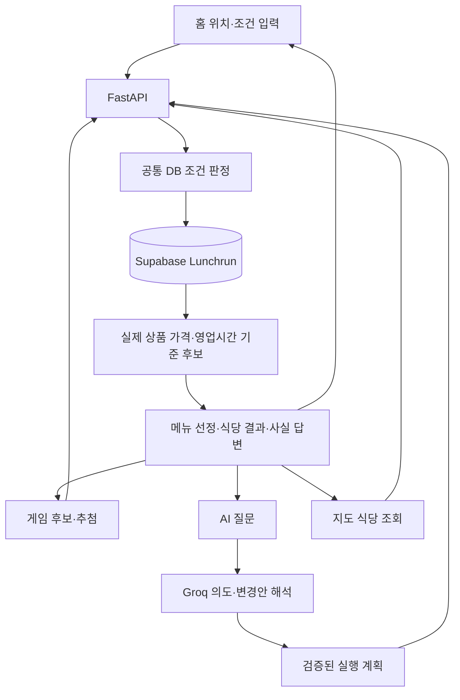
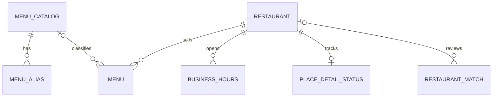

# LunchRun — 위치와 조건으로 고르는 점심 메뉴·식당 추천

LunchRun은 사용자의 **현재 위치, 검색 반경, 예산, 음식 종류와 점심시간**을 바탕으로 메뉴를 고르고 주변 식당을 찾는 웹 애플리케이션입니다. 게임이나 AI 채팅으로 메뉴를 정한 뒤 카카오 지도에서 검증된 식당과 이동 경로를 확인할 수 있습니다. 채팅으로 메뉴를 다시 추천받거나 최근 추천한 식당의 가격·주소·영업 여부도 물어볼 수 있습니다.

홈·게임·AI·지도는 **미리 구축한 Supabase PostgreSQL의 `Lunchrun` DB**에서 메뉴·가격·영업시간·식당을 조회합니다. 일반 추천 요청은 카카오 식당 검색이나 상세 수집을 실행하지 않습니다. Groq는 질문 의도를 해석하고 사실 답변은 서버가 DB 결과로 작성합니다.

현재는 **Supabase PostgreSQL과 단일 FastAPI 프로세스로 실행하는 개발용 프로토타입**입니다. CSV 식당·전체 상품 적재와 대표 메뉴 연결, 영업시간 보완을 완료했습니다. Redis와 실제 로그인 인증은 아직 연결하지 않았습니다.

> 백엔드와 DB를 처음 살펴본다면 [DB 중심 전환·최종 점검 기록](docs/db_first_stage6_final_verification.md)부터 읽어주세요. 기존 [백엔드 안내](BACKEND_DB_GUIDE.md)에는 전환 전 설명이 남아 있으므로 현재 DB 동작은 이 README를 기준으로 확인하세요. 코드 읽는 순서, 직접 확인할 항목, 수정 후 검증 방법을 설명합니다.

> 챗봇의 질문 해석과 응답 규칙을 바꾸려면 [초보자용 가드레일 수정·설정 가이드](CHATBOT_GUARDRAIL_GUIDE_v1.md)를 참고하세요. 현재 적용 파일과 프롬프트·스키마·실행 로직의 연결을 설명합니다.

## 로컬 실행

Windows PowerShell, Python 3.13 환경을 기준으로 합니다. **이미 가상환경과 환경변수가 준비되어 있다면 서버 두 개만 실행하면 됩니다.**

### 1. FastAPI 서버 실행

첫 번째 터미널:

```powershell
cd C:\temp_resolved
.\.venv\Scripts\python.exe -m uvicorn app.main:app --reload --host 127.0.0.1 --port 8000
```

### 2. 게임 서버 실행

두 번째 터미널:

```powershell
cd C:\temp_resolved
$env:PYTHON_BIN = "C:\temp_resolved\.venv\Scripts\python.exe"
$env:HOST = '0.0.0.0'
$env:PORT = '4174'
node .\games\server.mjs
```

`HOST`와 `PORT`는 게임 서버가 요청을 받을 주소와 포트입니다. DB 접속 주소나 DB 포트 `5432`를 넣지 않습니다. 위 설정은 현재 PowerShell 창에만 적용되며, 기존 환경변수 때문에 `listen EADDRNOTAVAIL`이 발생하는 것을 방지합니다. DB 연결은 `.env`의 `SUPABASE_DB_URL` 또는 `DATABASE_URL`에 설정합니다. 자세한 해결 절차는 [주소·포트 오류 해결](LOCAL_RUN_TROUBLESHOOTING.md#listen-eaddrnotavail-address-not-available)을 참고하세요.

게임 서버 기본 포트는 4174이고 FastAPI 기본 포트는 8000입니다. 사용자는 **http://127.0.0.1:8000**으로 접속합니다. 게임도 같은 서버의 `/games/`, 지도는 `/map/`으로 엽니다. 지도 전용 서버를 추가로 실행할 필요는 없습니다.

| 주소 | 용도 |
|---|---|
| `http://127.0.0.1:8000/` | 홈: 위치·예산·반경·음식 조건 설정 |
| `http://127.0.0.1:8000/ai` | 독립 AI 채팅 화면 |
| `http://127.0.0.1:8000/games/` | 게임 선택 |
| `http://127.0.0.1:8000/games/play` | 게임 실행·결과 |
| `http://127.0.0.1:8000/map/` | 카카오 지도와 DB 식당 결과 |
| `http://127.0.0.1:8000/docs` | API 문서 |
| `http://127.0.0.1:8000/api/readiness` | DB·활성 메뉴·설정 점검 |

조건 입력은 `/`, AI는 `/ai`를 사용합니다. `/conditions`는 `/`로 이동하는 이전 주소 호환용 별칭입니다. 예산·시간·거리·인원 설정은 `/budget`, `/time`, `/distance`, `/people`로 이동합니다. 직접 접속과 새로고침도 지원합니다. 이전 해시 북마크는 일반 주소로 정리하며 화면 전환은 pathname과 History API를 사용합니다. [일반 경로 전환 기록](docs/frontend_plain_routes.md)을 참고하세요.

홈·공통 헤더·조건 입력 화면에 프론트 디자인을 적용했습니다. 기존 실제 위치·주소 검색, 15개 음식 조건, DB 메뉴·가격 표시를 유지하며 모바일에서는 같은 디자인을 화면 너비에 맞춰 표시합니다. [2단계 디자인 병합 결과](docs/frontend_merge_stage2_results.md)에 변경 범위와 화면 비교를 정리했습니다.

게임 선택·실행 화면에도 프론트 디자인을 적용했습니다. 게임 선택은 `/games/`, 실행·결과는 `/games/play`를 사용하며 DB 메뉴 후보와 다인 방 조건을 유지합니다. AI는 `/ai`, 식당·경로는 `/map/`으로 연결합니다. 게임 서버 코드를 적용한 뒤에는 Node 서버를 재시작합니다. [3단계 게임 병합 결과](docs/frontend_merge_stage3_results.md)에 검증 범위와 화면을 정리했습니다.

독립 `/ai`에는 프론트의 말풍선·입력창·전송 버튼 디자인을 적용했습니다. DB 기반 답변, 조건 변경안 적용, 대화 복원, 진행 상태·취소·재시도와 Enter/Shift+Enter 기능을 유지합니다. [4단계 AI 병합 결과](docs/frontend_merge_stage4_results.md)에서 화면과 검증 내용을 확인할 수 있습니다.

### 처음 설치하는 경우

```powershell
cd C:\temp_resolved
python -m venv .venv
.\.venv\Scripts\python.exe -m pip install -r requirements.txt
```

프로젝트 최상위 `.env`에 아래 설정을 추가합니다. 이미 설정했다면 덮어쓰지 않습니다.

```dotenv
SUPABASE_DB_URL=postgresql://DB_USER:URL_ENCODED_PASSWORD@DB_HOST:5432/postgres?sslmode=require
MAP_API_KEY=your_kakao_rest_api_key
KAKAO_JAVASCRIPT_KEY=your_kakao_javascript_key
GROQ_API_KEY=your_groq_api_key
GROQ_MODEL=openai/gpt-oss-20b
```

`SUPABASE_DB_URL`은 PostgreSQL 연결 문자열입니다. 프로젝트 웹 URL이나 publishable 키를 대신 넣지 않습니다. 비밀번호의 특수문자는 URL 인코딩하며 연결 주소·포트는 사용하는 Supabase 연결 방식에 맞춥니다. `DATABASE_URL`이 별도로 있으면 그 값이 우선하므로 이전 SQLite 설정이 남아 있지 않은지 확인합니다.

**현재 연결한 Supabase는 이미 테이블과 데이터가 준비되어 있습니다.** 서버를 켤 때 재적재·시드 등록·마이그레이션을 반복하지 않습니다. PostgreSQL 시작 검사는 `Lunchrun.alembic_version`의 `0004_csv_import_records`를 확인합니다.

새 빈 DB를 준비하는 작업은 별도 구축 절차입니다. 대소문자를 구분하는 `"Lunchrun"` 스키마를 먼저 준비한 뒤 `python -m alembic upgrade head`를 적용합니다. 기존 데이터가 있는 DB에 초기 구축용 0003 마이그레이션을 다시 적용하면 안 됩니다. `public`에는 애플리케이션 테이블을 생성·적재하지 않습니다.

Chromium은 **상세정보 수집 작업과 브라우저 테스트에만** 필요합니다. 일반 DB 추천 서버 실행에는 필요하지 않습니다. 해당 작업을 수행할 때만 설치합니다.

```powershell
.\.venv\Scripts\python.exe -m playwright install chromium
```

홈 소스를 수정했다면 `node frontend/build.cjs`로 번들을 갱신합니다. 기존 번들이 있으면 화면 실행 전에 별도 npm 빌드를 할 필요는 없습니다.

실행 문제는 [로컬 실행 문제 해결](LOCAL_RUN_TROUBLESHOOTING.md), 게임 관련 설명은 [게임 실행 안내](games/README.md)를 참고하세요.

## 목차

- [로컬 실행](#로컬-실행)
- [주요 기능](#주요-기능)
- [동작 방식](#동작-방식)
- [기술 구성](#기술-구성)
- [환경설정](#환경설정)
- [API](#api)
- [DB 구조](#db-구조)
- [프로젝트 구조](#프로젝트-구조)
- [테스트](#테스트)
- [현재 제한과 확인할 문제](#현재-제한과-확인할-문제)
- [구현 단계와 참고 문서](#구현-단계와-참고-문서)

## 주요 기능

| 기능 | 설명 |
|---|---|
| 기준 위치 설정 | 브라우저 현재 위치 또는 카카오 주소·장소 검색 결과를 사용 |
| 화면 이동 | 조건 설정 → 게임·AI 메뉴 결정 → 카카오 지도의 순서로 진행하고 뒤로 가기도 역순으로 동작 |
| 게임 메뉴 선정 | 현재 조건에 맞는 백엔드 메뉴 후보를 제비뽑기·가챠·룰렛·사다리 등으로 선정 |
| AI 메뉴 선정 | 백엔드 대화 정책에 따라 메뉴 추천, 조건 변경 제안, 식당 검색과 후속 질문 처리 |
| 메뉴 재추천 | 채팅 재추천에서 현재·최근 선정 메뉴를 제외 |
| 식당 검색 | 선정 메뉴 FK와 현재 조건으로 Lunchrun DB 식당 조회 |
| 카카오 지도 | 실제 좌표의 식당 핀·목록·상세정보·도보 경로를 한 화면에 표시 |
| 겹친 식당 표시 | 같은 위치에 겹친 식당은 숫자 클러스터로 묶고 선택 목록 제공 |
| 상세정보 저장 | 메뉴·가격·요일별 영업 구간·휴무·익일 종료를 저장 |
| 추천 필터 | 메뉴 판매, 예산, 한국 시간 기준 영업 여부 확인 |
| 식당 후속 질문 | 최근 추천 식당의 가격·주소·메뉴·영업 여부·추천 근거 조회 |
| 대화 복원 | 같은 브라우저에서 최근 10턴과 선택 상태 복원 |
| 진행상태 표시 | 의도 해석·DB 조회·조건 판정의 스트리밍 메시지 표시 |
| 화면 간 상태 공유 | 조건·위치·선택 메뉴·식당 결과·채팅 상태를 같은 브라우저 탭에서 공유 |
| 운영 진단 | health/readiness, 요청 ID, 구조화 로그, 세션별 요청 제한 |

채식·맵기·알레르기·실제 이동 및 대기시간은 현재 데이터로 검증하지 않습니다. 화면에 관련 입력이 남아 있어도 해당 조건 충족을 보장하지 않습니다.

## 동작 방식

```text
/ → /games/ → /map/
   조건 설정      메뉴 결정    식당·경로 확인
```

뒤로 가기는 역순으로 이동합니다. 화면은 같은 탭의 공통 상태를 공유하며 위치·예산·반경·음식 조건을 바꾸면 이전 메뉴와 식당 결과를 무효화합니다.

AI 추천은 독립 `/ai`에서 사용하며 홈과 게임의 AI 버튼 모두 해당 주소로 연결합니다. 게임 자체는 기존 일반 경로 `/games/`를 유지합니다.



### 메뉴와 가격은 어디서 나오나요?

`menu_catalog` 대표 메뉴와 `menu.menu_catalog_id`로 확정 연결한 **실제 식당 상품**을 조회합니다. 반경·매장 업종·예산·저장된 현재 영업시간을 통과한 상품만 후보로 사용하고, 홈에서 가격 범위와 식당 수를 확인할 수 있습니다. 게임·AI·지도도 `app/db_recommendations.py`의 같은 판정을 사용합니다.

- 실제 상품 근거가 없으면 후보 없음으로 안내합니다. seed의 `price_hint`로 보충하지 않습니다.
- 인분 미확인 상품도 **매장 표시 가격 기준**으로 예산을 비교하되 미확인 안내를 표시합니다. 1인분 가격으로 환산하지 않습니다.
- 확인 가격·대표 메뉴 연결·영업정보가 없는 상품은 추천하지 않습니다.
- 품절·폐업이 확인된 데이터는 제외합니다. 판매 상태 미확인은 경고를 표시합니다.
- 저장된 시간표는 실시간 매장 상태를 보장하지 않습니다. 실제 이동·대기·식사시간과 단체 좌석 확보도 검증하지 않습니다.

### 카카오 API와 별도 수집 작업

사용자가 식당을 조회할 때 **카카오 식당 검색이나 Playwright 수집을 새로 실행하지 않습니다.** 사전에 적재한 식당·상품·가격·영업시간을 DB에서 읽습니다.

카카오 지도 SDK·지도 타일, 주소·장소 검색·좌표 주소 변환과 길찾기는 계속 사용합니다. `place_url`의 메뉴·영업시간 보완은 추천 요청과 분리한 관리 작업입니다. 페이지 구조 변경이나 수집 실패는 보완 작업에서 검토하고 미확인 정보를 추측해서 채우지 않습니다.

### 지도 화면

기존 남색·주황색 틀과 식당 목록·지도·상세 카드 배치를 유지합니다. DB 조건을 통과한 식당을 실제 좌표에 표시하고 저장된 전체 메뉴·가격·요일별 영업시간과 카카오맵 상세 링크를 제공합니다. 위치·예산·반경·업종을 바꾸면 선택 메뉴를 다시 검증합니다. 겹친 핀은 `2`, `3`처럼 숫자만 표시하며 도보 경로·출발지 변경 기능도 유지합니다.

### AI 채팅

홈과 게임은 같은 `/api/chat/stream`을 사용합니다. **Groq는 질문의 의도와 대상을 해석하고, 사실 답변은 서버가 DB에서 조회합니다.**

- 메뉴 추천 → 메뉴·가격 질문 → 식당 조회 → 최근 식당의 주소·가격·영업 질문을 이어갈 수 있습니다.
- 메뉴 추천 단계도 주변 DB 상품을 조회하지만 식당 결과 목록을 자동으로 표시하지는 않습니다.
- 조건 변경안은 사용자가 `조건 적용`을 눌러 확정합니다. 검색 동의가 포함된 제안만 적용 후 조회합니다.
- 조건 변경 뒤 이전 식당 목록을 새 조건의 근거로 재사용하지 않습니다.
- 최근 10턴은 서버 메모리에 저장하며 화면의 최신 조건을 과거 대화 값으로 덮어쓰지 않습니다.
- `Enter`로 전송하고 `Shift+Enter`로 줄바꿈합니다.

## 기술 구성

| 영역     | 사용 기술                            | 현재 역할                 |
| ------ | -------------------------------- | --------------------- |
| 백엔드    | Python, FastAPI                  | API, 서비스 실행, 정적 화면 제공 |
| 검증     | Pydantic                         | 요청 범위와 Groq 구조화 응답 검증 |
| DB | Supabase PostgreSQL, SQLAlchemy, psycopg | Lunchrun 스키마의 메뉴·식당·상세정보 조회 |
| 스키마 이력 | Alembic                          | 초기 스키마와 이후 구조 변경 관리   |
| AI     | Groq API                         | 한국어 질문 의도와 대상 해석      |
| 위치·장소  | 브라우저 Geolocation, 카카오 API/지도 SDK | 위치 선택, 장소 검색, 지도 표시   |
| 상세수집 | Playwright Chromium | 추천 요청과 분리한 관리 수집 작업 |
| 화면     | HTML, CSS, JavaScript            | 별도 프론트 빌드 없이 실행       |
| 테스트    | pytest, Node.js 기본 테스트 러너        | 서버·DB·화면 로직 검증        |

`requirements.txt`에는 Supabase, Redis 등 기존 실험용 의존성도 포함되어 있습니다. 패키지가 설치되어 있다는 사실과 실제 기능이 연결되어 있다는 사실은 다릅니다. 현재 세션·요청 제한은 메모리 방식이며 별도 Redis 서버 없이 실행합니다.

## 환경설정

환경변수가 `.env`보다 우선하며, 설정 변경 후에는 서버를 다시 시작합니다.

| 변수 | 기본값 | 설명 |
|---|---|---|
| `SUPABASE_DB_URL` | 설정 필요 | 현재 Supabase PostgreSQL 연결 문자열 |
| `DATABASE_URL` | 미설정 | 지정하면 SUPABASE_DB_URL보다 우선. 둘 다 없으면 SQLite 호환 경로 사용 |
| `GROQ_MODEL` | `openai/gpt-oss-20b` | 질문 해석 모델 |
| `GROQ_TIMEOUT_SECONDS` | `30` | Groq 처리 제한시간 |
| `GROQ_MAX_COMPLETION_TOKENS` | `1024` | 구조화 응답 출력 한도 |
| `CHAT_SESSION_TTL_SECONDS` | `86400` | 메모리 세션 만료 설정 |
| `COOKIE_SECURE` | `false` | HTTPS 배포에서는 `true` |
| `DETAIL_SUCCESS_TTL_HOURS` | `168` | 별도 상세수집 작업의 재수집 주기 |
| `DETAIL_FAILURE_RETRY_MINUTES` | `60` | 별도 상세수집 작업의 실패 재시도 간격 |
| `CHAT_REQUESTS_PER_MINUTE` | `10` | 세션별 최근 60초 채팅 한도 |
| `CHAT_REQUESTS_PER_DAY` | `100` | 세션별 최근 24시간 채팅 한도 |
| `MAX_REQUEST_BYTES` | `65536` | Content-Length 기준 요청 크기 제한 |

`.env.example`이 없는 작업본에서는 위의 설정 예시를 참고합니다. `SUPABASE_URL`과 publishable 키만 설정해서는 SQLAlchemy DB 연결이 되지 않습니다. `APP_ORIGIN`은 현재 서버 설정 모델에서 읽지 않습니다.

## API

| 메서드  | 경로                       | 역할                   |
| ---- | ------------------------ | -------------------- |
| GET  | `/api/health`            | 서버 생존 확인             |
| GET  | `/api/readiness`         | 실행 준비 조건 점검          |
| GET  | `/api/public-config`     | 브라우저 지도 SDK용 공개 설정   |
| GET  | `/api/groq/status`       | 실제 Groq 연결 확인과 서버 캐시 |
| POST | `/api/locations/search`  | 주소·장소 검색             |
| POST | `/api/locations/reverse` | 좌표의 주소 조회            |
| POST | `/api/recommendations`   | DB 메뉴 선정 및 식당 조회·판정     |
| POST | `/api/menus/candidates`  | 게임과 조건 화면에 검증된 메뉴 후보 제공 |
| POST | `/api/chat`              | 최종 JSON 채팅 응답        |
| POST | `/api/chat/stream`       | 단계별 NDJSON 채팅 응답     |
| GET  | `/api/chat/session`      | 현재 브라우저 세션 복원        |
| GET, POST | `/games/{path}` | 게임 화면·방 API를 Node.js 게임 서버로 전달 |
| GET | `/map/` | 카카오 지도와 식당 목록 화면 |
| POST | `/map/api/nearby` | 메뉴를 정하지 않은 주변 식당 조회 |
| GET | `/map/api/restaurants/{id}` | 식당 메뉴·가격·영업시간 상세 조회 |
| POST | `/map/api/walking-route` | 선택 식당까지의 도보 경로 조회 |
| GET | `/map/api/menu-search` | DB 전체 식당 메뉴 검색 |

채팅 요청 예시:

```json
{
  "message": "이 메뉴 파는 식당 보여줘",
  "location": {
    "lat": 37.48,
    "lng": 126.88,
    "name": "예시 위치",
    "source": "place"
  },
  "radius_m": 500,
  "conditions": {"budget": 10000, "cuisine": "전체"},
  "menu_id": "noodle"
}
```

스트림은 `application/x-ndjson`으로 한 줄에 한 JSON 객체를 전달합니다. 주요 이벤트는 `started`, `interpreting`, `checking_database`, `searching`, `filtering`, `completed`, `failed`입니다. 완료 결과는 `completed.data`에 들어 있습니다. 스트림 시작 뒤 발생한 실패는 HTTP 상태만 보지 말고 `failed` 이벤트도 확인해야 합니다.

반경은 50~500m, 예산은 1,000~100,000원 범위입니다. 채팅 조건 변경은 현재 화면에 변경안을 보여주고 적용 버튼으로 확인하는 구조입니다. 조건만 변경하면 다시 추천을 요청합니다. 검색 동의가 포함된 제안은 적용 후 조회를 실행합니다.

## DB 구조

실제 서비스 데이터는 **Supabase PostgreSQL의 대소문자를 구분하는 `"Lunchrun"` 스키마**에 저장합니다. SQLAlchemy는 ORM이며 SQLite와 대체 관계가 아닙니다. SQLite는 격리된 테스트·로컬 호환용으로 남아 있고, 현재 운영 연결은 `SUPABASE_DB_URL`을 사용합니다.



| 테이블 | 역할과 저장 규칙 |
|---|---|
| `menu_catalog` | 대표 메뉴 152종. 활성 여부와 분류 관리. 기존 `price_hint`·설명 필드는 호환용이며 추천 가격 근거로 사용하지 않음 |
| `menu_alias` | 대표 메뉴 별칭. 조회 시 상품명을 부분 일치로 추측하지 않고 적재 시 확정한 FK를 사용 |
| `restaurant` | 내부 UUID PK. 카카오 ID는 별도의 nullable·unique 식별자이며 주소·좌표·place_url·운영 상태 저장 |
| `menu` | 식당 FK와 nullable 대표 메뉴 FK, 전체 상품명·실제 가격·가격 상태·판매 상태·출처·확인 시각 |
| `business_hours` | 요일별 영업 구간·휴무·익일 종료·브레이크타임 분할·라스트오더·출처·확인 시각 |
| `place_detail_status` | 식당별 메뉴·영업시간 수집 결과와 각각의 최근 성공 시각 |
| `restaurant_match` | 식당 카카오 ID 매칭 확정·검토·미발견 내역 |
| `csv_import_record` | 적재·정제 감사 기록 JSONB. 상품 분류와 인분 확인 정보, 영업시간 보완 결과를 보관하며 직접 FK는 없음 |
| `alembic_version` | 현재 마이그레이션 버전 `0004_csv_import_records` |

상품은 전체를 보존하고 대표 메뉴로 확정한 상품만 `menu.menu_catalog_id`에 연결했습니다. 미연결·검토 대상은 삭제하지 않으며 추천 후보에서는 제외합니다. 인분 판정은 현재 상품 테이블의 전용 열이 아닌 적재 감사 기록에서 읽고, 확인되지 않으면 미확인으로 처리합니다.

가격은 `known`이면 양의 정수이고, `missing`·`variable`이면 SQL `NULL`입니다. 미확인 가격을 0원으로 처리하지 않습니다. 판매 상태는 `available`·`sold_out`·`unknown`이며 품절은 제외하고 미확인은 경고와 함께 허용합니다.

수집 상태는 `pending`·`success`·`missing`·`fetch_failed`·`parse_failed`입니다. 메뉴·영업정보가 성공 상태이고 현재 영업시간·휴무가 확인된 식당만 추천합니다. 수집 실패 시 기존 행이 남아 있어도 성공 정보로 간주하지 않습니다.

**구축 검증 당시 수량:** 식당 2,174곳, 전체 상품 35,231건, 대표 메뉴 152종, 대표 메뉴 연결 상품 2,969건, 영업시간 11,083행. 전체 식당이 추천 가능한 것은 아니며 위치·예산·연결 상태·영업시간에 따라 후보가 줄어듭니다.

PostgreSQL의 사용자 요청 세션은 읽기 전용입니다. CSV 적재와 영업시간 보완은 별도 관리 작업으로 수행하며 일반 추천 요청은 데이터를 추가·변경하지 않습니다. 브라우저가 Supabase 테이블을 직접 조회하는 구조가 아니므로 DB 접속 비밀값을 화면에 전달하지 않습니다.

최종 저장 규칙과 구축 이력은 [DB 설계](docs/db_first_stage1_design.md), [적재 결과](docs/db_first_stage3_import_results.md), [영업시간 보완](docs/db_first_stage4_hours_results.md), [DB 중심 흐름 전환](docs/db_first_stage5_flow_results.md)을 참고하세요.

## 프로젝트 구조

```text
LunchRun/
├─ README.md                   # 공개 프로젝트 소개와 실행 안내
├─ BACKEND_DB_GUIDE.md          # 초보자용 백엔드·DB 확인 및 수정 안내
├─ app/
│  ├─ main.py                  # 앱 시작, DB 버전 확인, HTTP 미들웨어
│  ├─ api.py                   # 추천·채팅·상태 API
│  ├─ locations.py             # 위치 API
│  ├─ schemas.py               # 요청 형식과 범위
│  ├─ services.py              # 질문 의도별 실행과 DB 답변
│  ├─ chat_policy.py           # Groq 응답 계약과 프롬프트 경로
│  ├─ chat_sessions.py         # 메모리 대화 상태
│  ├─ menu_catalog.py          # DB 후보 조회·추첨 인터페이스
│  ├─ db_recommendations.py    # 홈·게임·AI·지도 공통 DB 조건 판정
│  ├─ recommendation_engine.py # 가격·영업시간 필터
│  ├─ detail_collection.py     # 캐시와 상세수집 순서
│  ├─ place_details.py         # 수집 문자열 정규화
│  ├─ clients/                # 카카오·Groq 통신
│  ├─ collectors/             # Playwright 페이지 수집
│  ├─ repositories/           # 식당·상세정보 저장
│  ├─ database/               # 모델·연결·초기 메뉴 시드
│  ├─ prompts/                # 버전별 프롬프트·예시·안내문
│  ├─ operations.py           # readiness 진단
│  ├─ observability.py        # JSON 로그
│  └─ rate_limit.py           # 메모리 요청 제한
├─ frontend/                  # 조건 화면, 공통 상태·위치 선택·AI 채팅
├─ games/                     # 메뉴 게임 화면, 다인 방과 Node.js 서버
├─ kakao-map/                 # 카카오 지도, 식당 목록·상세·경로 화면
├─ alembic/                   # DB 마이그레이션
├─ tests/                     # 서버·DB·화면 테스트
├─ docs/                      # 단계별 설계·검증 문서
├─ requirements.txt           # Python 의존성
└─ run.ps1                    # Windows 로컬 실행
```

## 테스트

전체 Python 테스트:

```powershell
.\.venv\Scripts\python.exe -m pytest -q
```

프론트엔드 테스트:

```powershell
node --test tests/*.test.cjs
```

게임 서버 테스트:

```powershell
node --test games\room-store.test.mjs games\network.test.mjs
```

기본 테스트는 외부 API를 모의 처리합니다. 실제 외부 검사는 선택적으로 켭니다.

```powershell
$env:LUNCHRUN_LIVE_GROQ = "1"
.\.venv\Scripts\python.exe -m pytest tests\test_guardrail_live.py::LiveGuardrailTests -v
Remove-Item Env:LUNCHRUN_LIVE_GROQ
```

```powershell
$env:LUNCHRUN_LIVE_INTEGRATION = "1"
.\.venv\Scripts\python.exe -m pytest tests\test_guardrail_live.py::LiveIntegrationTests -v
Remove-Item Env:LUNCHRUN_LIVE_INTEGRATION
```

2026-11-13 최종 검증 결과는 Python **160 passed, 2 skipped, 54 subtests passed**, 프론트·게임 Node **35 passed**입니다. 건너뛴 2개는 실제 외부 API를 사용하는 선택 검사입니다. 실제 Chromium에서 홈·게임·AI·위치·지도와 역순 이동을 확인했고, 실제 Supabase API의 공통 결과와 데이터 보존도 별도로 검증했습니다. 자세한 범위와 제한은 [최종 점검 기록](docs/db_first_stage6_final_verification.md)에 정리했습니다.

외부 API 선택 검사는 사용량을 소비합니다. 기본 회귀 테스트는 외부 응답을 모의 처리하며 실제 키·등록 도메인의 유효성까지 보장하지 않습니다. Starlette TestClient의 httpx 사용 관련 경고 1개가 남아 있어 의존성 업데이트 시 확인이 필요합니다.

## 현재 제한과 확인할 문제

- 특정 메뉴를 먹고 싶다는 표현을 선택으로 확정하는 의도가 없어 랜덤 메뉴로 응답할 수 있습니다. `김치찌개 먹고 싶어` 사례는 아직 수정하지 않았습니다.
- 음식 조건 변경은 제안·적용 방식입니다. 단순 변경 후에는 다시 추천을 요청하며 검색 동의가 포함된 제안만 적용 후 조회합니다.
- 상세페이지가 없거나 파싱에 실패하면 추천 수가 적거나 없을 수 있습니다. 빈 결과를 가상의 식당으로 채우지 않습니다.
- 메뉴 카탈로그 관리 화면과 데이터 정기 갱신 자동화는 없습니다. Supabase 시작 시 seed를 추가하지 않으며 카탈로그 확장은 별도 관리 작업입니다.
- 대화는 최근 10턴이며 메모리 세션이므로 서버 재시작·reload 시 사라집니다.
- 요청 제한과 중복 스트림 차단은 단일 프로세스 기준입니다. 쿠키 재발급에 의한 우회 방지나 다중 서버 공유 제한까지 구현된 것은 아닙니다.
- Content-Length 기반 제한 외에 실제 수신 바이트 제한은 운영 프록시와 함께 보강할 여지가 있습니다.
- 현재 HTTP 요청 로그 처리시간은 응답 헤더 준비 시점 기준이며 스트림 전체 완료시간과 다를 수 있습니다.
- readiness의 Chromium 확인은 선택적 수집 도구 진단입니다. 설치되지 않아도 DB 추천 준비 상태를 실패 처리하지 않습니다.
- Supabase DB 전환은 완료했습니다. Supabase Auth·Redis 작업 큐·다중 서버 배포는 아직 수행하지 않았습니다.

## 구현 단계와 참고 문서

현재 DB 전환 기록: [1단계 ERD·저장 규칙](docs/db_first_stage1_design.md), [2단계 연결·테이블](docs/db_first_stage2_results.md), [3단계 CSV 적재](docs/db_first_stage3_import_results.md), [4단계 영업시간](docs/db_first_stage4_hours_results.md), [5단계 공통 조회](docs/db_first_stage5_flow_results.md), [6단계 최종 점검](docs/db_first_stage6_final_verification.md).

아래 문서는 전환 전 구현 과정의 참고 이력입니다.

| 단계 | 주제 | 문서 |
|---|---|---|
| 1 | 추천 정책과 역할 분리 | [초기 정책 기록 — 보관본](docs_old/docs/chatbot_policy_v1.md) |
| 2 | 메뉴 카탈로그와 후보 선정 | [카탈로그 설계](docs/menu_catalog_design_v1.md) |
| 3 | 최근 10턴 세션과 복원 | [현재 백엔드·DB 안내](BACKEND_DB_GUIDE.md) |
| 4 | Groq 의도·대상 가드레일 | [현재 가드레일 안내](CHATBOT_GUARDRAIL_GUIDE_v1.md) |
| 5 | DB 추천과 후속 질문 | [DB 챗봇 설계](docs/db_chat_action_design_v1.md) |
| 6 | 스트리밍과 캐시 | [스트리밍 설계](docs/streaming_chat_design_v1.md) |
| 7 | 마이그레이션과 운영 준비 | [7단계 검증](docs/step7_integration_verification_v1.md) |

현재 코드가 읽는 질문 지침은 `system_v4.txt`, 해석 예시는 `examples_v3.json`, 안전 안내문은 `replies_v4.json`입니다. 정책 문서의 최신 파일은 [chatbot_policy_v4.md](docs/chatbot_policy_v4.md)입니다. 문서 버전 숫자와 프롬프트 버전 숫자가 항상 같지는 않습니다.

추가 자료: [통합 구조](docs/integration_architecture_v1.md), [DB 마이그레이션](docs/database_migration_guide_v1.md), [운영 점검표](docs/operations_checklist_v1.md).

현재 코드와 달라진 이전 안내·정책·검증 문서는 [docs_old 보관 목록](docs_old/README.md)에서 확인할 수 있습니다. 보관본은 당시 구현 이력이며 현재 설정 지침으로 사용하지 않습니다.

### 지도 화면 디자인 통합

`/map/`은 지도·식당 상세·길찾기를 한 화면에서 제공하며 기존 Lunchrun DB 조회 흐름을 유지합니다. 홈·게임과 공통 헤더 및 화면 이동 메뉴를 사용하고, 식당 목록·메뉴/가격 대화상자·조건 입력창은 공통 디자인으로 표시합니다. 자세한 변경 및 검증 내역은 [지도 디자인 통합 결과](docs/frontend_merge_stage5_results.md)를 참고하세요.
