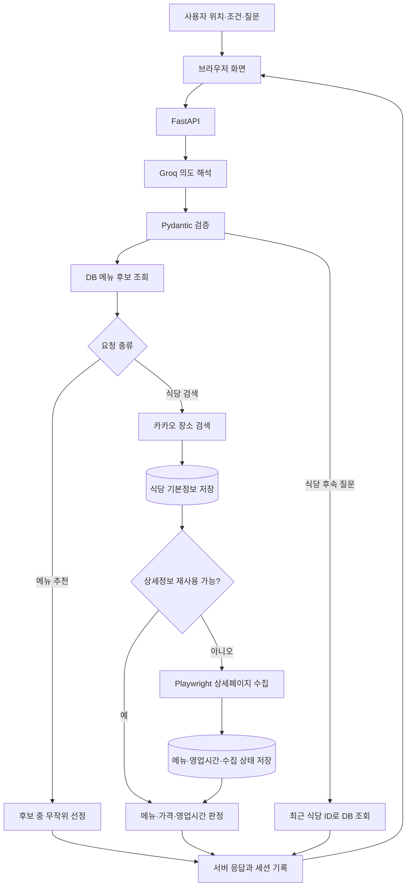
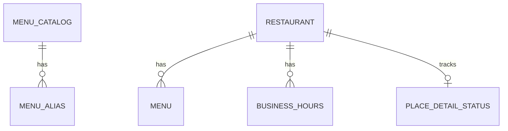

# LunchRun — 위치와 조건으로 고르는 점심 메뉴·식당 추천

LunchRun은 사용자의 **위치, 검색 반경, 예산, 음식 종류**를 바탕으로 점심 메뉴를 고르고 주변 식당을 찾는 웹 애플리케이션입니다. 채팅으로 메뉴를 다시 추천받거나, 최근 추천한 식당의 가격·주소·영업 여부를 물어볼 수 있습니다.

FastAPI 서버가 카카오 장소 검색 API로 식당 기본정보를 가져오고, 카카오 상세페이지에서 확인한 메뉴·가격·영업시간을 SQLite에 저장합니다. Groq는 사용자 문장을 의도로 해석하며, 실제 추천과 사실 정보 답변은 서버가 DB를 조회해 처리합니다.

현재는 **SQLite와 단일 FastAPI 프로세스로 실행하는 개발용 프로토타입**입니다. Supabase PostgreSQL 이전을 위한 SQLAlchemy 모델과 Alembic 마이그레이션이 준비되어 있으며, Redis와 실제 로그인 인증은 아직 연결하지 않았습니다.

> 백엔드와 DB를 처음 살펴본다면 [BACKEND_DB_GUIDE.md](BACKEND_DB_GUIDE.md)부터 읽어주세요. 코드 읽는 순서, 직접 확인할 항목, 수정 후 검증 방법을 설명합니다.

> 챗봇의 질문 해석과 응답 규칙을 바꾸려면 [초보자용 가드레일 수정·설정 가이드](CHATBOT_GUARDRAIL_GUIDE_v1.md)를 참고하세요. 현재 적용 파일과 프롬프트·스키마·실행 로직의 연결을 설명합니다.

## 목차

- [주요 기능](#주요-기능)
- [동작 방식](#동작-방식)
- [기술 구성](#기술-구성)
- [로컬 실행](#로컬-실행)
- [환경설정](#환경설정)
- [API](#api)
- [DB 구조](#db-구조)
- [프로젝트 구조](#프로젝트-구조)
- [테스트](#테스트)
- [현재 제한과 확인할 문제](#현재-제한과-확인할-문제)
- [구현 단계와 참고 문서](#구현-단계와-참고-문서)

## 주요 기능

| 기능 | 설명 |
|---|---|
| 기준 위치 설정 | 브라우저 현재 위치 또는 카카오 주소·장소 검색 결과를 사용 |
| 메뉴 선정 | 현재 조건에 맞는 DB 메뉴 후보 중 무작위 선정 |
| 메뉴 재추천 | 채팅 재추천에서 현재·최근 선정 메뉴를 제외 |
| 식당 검색 | 선정 메뉴의 검색어로 설정 반경 안의 식당 조회 |
| 상세정보 저장 | 메뉴·가격·요일별 영업 구간·휴무·익일 종료를 저장 |
| 추천 필터 | 메뉴 판매, 예산, 한국 시간 기준 영업 여부 확인 |
| 식당 후속 질문 | 최근 추천 식당의 가격·주소·메뉴·영업 여부·추천 근거 조회 |
| 대화 복원 | 같은 브라우저에서 최근 10턴과 선택 상태 복원 |
| 진행상태 표시 | 스트리밍 단계 메시지와 수집 진행률·스피너 표시 |
| 운영 진단 | health/readiness, 요청 ID, 구조화 로그, 세션별 요청 제한 |

채식·맵기·알레르기·실제 이동 및 대기시간은 현재 데이터로 검증하지 않습니다. 화면에 관련 입력이 남아 있어도 해당 조건 충족을 보장하지 않습니다.

## 동작 방식



### 메뉴는 어디서 나오나요?

대표 메뉴는 `menu_catalog`, 같은 메뉴의 다른 표기는 `menu_alias`에서 관리합니다. 초기 시드는 비빔밥, 김치찌개, 두부 채소 덮밥, 짜장면, 짬뽕, 돈가스, 우동, 크림 파스타, 병아리콩 샐러드, 치즈 피자입니다.

1. 활성 카탈로그를 음식 종류와 제외 메뉴로 좁힙니다.
2. 설정 반경 안의 수집된 식당 메뉴 중 카탈로그와 연결되고 실제 가격이 예산 이내인 메뉴를 찾습니다.
3. 실제 근거가 하나라도 있으면 그 후보들만 사용합니다.
4. 실제 근거가 없으면 카탈로그의 `price_hint`가 예산 이내인 메뉴를 후보로 사용합니다.

`price_hint`는 후보 선정용 기준가격입니다. 식당에서 확인한 실제 가격이 아닙니다. 응답의 `source=database`/`catalog`, `price_verified`, `verified_price`로 근거를 구분합니다. 카탈로그에 연결되지 않은 수집 메뉴는 자동으로 새로운 대표 메뉴가 되지 않습니다.

### 식당 결과는 어떻게 구분하나요?

| 결과 | 현재 판정 |
|---|---|
| 추천 | 영업시간 수집 성공, 현재 영업 구간에 포함, 선택 메뉴 판매 확인, 확인 가격이 예산 이내 |
| 확인 필요 후보 | 영업 중으로 계산되지만 메뉴 자체가 미확인되었거나 선택 메뉴 가격을 확인하지 못함 |
| 제외 | 영업시간 미확인·수집 실패, 휴무·영업시간 밖, 선택 메뉴 없음, 확인 가격이 예산 초과 |

영업 구간에 포함되지만 휴무 여부가 `NULL`이면 `휴무일 확인 필요`를 함께 표시합니다. 이 경고만으로 검증 추천이 반드시 후보로 이동하는 것은 아닙니다.

현재 영업 여부는 저장된 시간표와 **Asia/Seoul 기준 요청 시각**을 비교한 결과입니다. 매장의 실시간 현장 확인 결과는 아닙니다. 브레이크 타임은 영업 구간을 여러 행으로 나누어 표현하고, 자정을 넘는 영업은 별도 플래그로 계산합니다.

### 카카오 API와 상세페이지의 차이

- 장소 검색 API: 카카오 ID, 업체명, 분류, 좌표, 주소, `place_url` 등의 기본정보를 가져옵니다.
- 상세페이지 수집: `place_url`을 Playwright로 열어 표시된 메뉴·가격·영업시간을 별도로 추출합니다.
- 정보가 없거나 페이지를 읽지 못하면 메뉴·가격·영업시간을 추측하지 않습니다.
- 상세수집 대상은 한 요청에서 최대 3곳이며 현재 검색의 첫 페이지를 기준으로 처리합니다.

상세페이지 수집은 공식 장소 검색 API와 별개의 기능입니다. 페이지 구조가 바뀌면 수집기를 점검해야 하며, 실제 운영 전 서비스 이용 조건과 접근 정책을 확인해야 합니다.

## 기술 구성

| 영역     | 사용 기술                            | 현재 역할                 |
| ------ | -------------------------------- | --------------------- |
| 백엔드    | Python, FastAPI                  | API, 서비스 실행, 정적 화면 제공 |
| 검증     | Pydantic                         | 요청 범위와 Groq 구조화 응답 검증 |
| DB     | SQLite, SQLAlchemy               | 메뉴·식당·상세정보 저장 및 조회    |
| 스키마 이력 | Alembic                          | 초기 스키마와 이후 구조 변경 관리   |
| AI     | Groq API                         | 한국어 질문 의도와 대상 해석      |
| 위치·장소  | 브라우저 Geolocation, 카카오 API/지도 SDK | 위치 선택, 장소 검색, 지도 표시   |
| 상세수집   | Playwright Chromium              | 동적 상세페이지 읽기           |
| 화면     | HTML, CSS, JavaScript            | 별도 프론트 빌드 없이 실행       |
| 테스트    | pytest, Node.js 기본 테스트 러너        | 서버·DB·화면 로직 검증        |

`requirements.txt`에는 Supabase, Redis 등 기존 실험용 의존성도 포함되어 있습니다. 패키지가 설치되어 있다는 사실과 실제 기능이 연결되어 있다는 사실은 다릅니다. 현재 세션·요청 제한은 메모리 방식이며 별도 Redis 서버 없이 실행합니다.

## 로컬 실행

아래 명령은 Windows PowerShell과 프로젝트 경로 `C:\TeamProject_1`을 기준으로 작성했습니다. 다른 위치에 저장했다면 해당 경로로 바꿔주세요. 실행 스크립트는 Python 3.12 이상을 안내하며, 개발 테스트 이력은 Python 3.13 환경을 사용했습니다.

### 1. 가상환경과 의존성 준비

```powershell
cd C:\TeamProject_1
python -m venv .venv
.\.venv\Scripts\python.exe -m pip install -r requirements.txt
.\.venv\Scripts\python.exe -m playwright install chromium
```

Node.js는 프론트엔드 테스트에만 필요합니다. 화면 실행 자체에는 npm 빌드가 없습니다.

### 2. 환경변수 설정

처음 설치한 경우 `.env.example`을 참고하여 프로젝트 최상위에 `.env`를 만듭니다. 이미 `.env`가 있다면 덮어쓰지 말고 필요한 항목만 추가합니다.

```dotenv
MAP_API_KEY=your_kakao_rest_api_key
KAKAO_JAVASCRIPT_KEY=your_kakao_javascript_key
GROQ_API_KEY=your_groq_api_key
GROQ_MODEL=openai/gpt-oss-20b
```

카카오 REST 키와 지도 SDK용 JavaScript 키는 구분해서 설정합니다. JavaScript 키에는 실제 접속 주소에 맞는 카카오 플랫폼 설정도 필요합니다. 모델명은 현재 코드의 기본값이며 실제 Groq 계정에서 사용 가능한 모델로 설정해야 합니다.

`MAP_API_KEY`가 비어 있으면 앱 설정 로딩이 실패합니다. Groq 키가 없으면 다른 기능은 실행할 수 있지만 채팅 요청은 실패하고 readiness도 준비되지 않은 상태를 표시합니다.

### 3. DB 준비

처음 만드는 **빈 DB**에는 다음을 실행할 수 있습니다.

```powershell
.\.venv\Scripts\alembic.exe upgrade head
```

앱 시작 시 누락 테이블 생성과 기본 메뉴 시드 등록도 실행됩니다. 기본 DB 경로는 `data/lunchrun.db`입니다.

기존 테이블과 데이터가 있는 DB는 초기 `upgrade`를 바로 실행하지 마세요. 현재 스키마를 확인하고 백업한 후 Alembic 기준선을 등록해야 합니다. 절차는 [DB 마이그레이션 안내](docs/database_migration_guide_v1.md)를 참고하세요. `stamp`는 현재 스키마를 자동 검증하거나 수정하는 명령이 아닙니다.

### 4. 서버 실행

```powershell
.\.venv\Scripts\python.exe -m uvicorn app.main:app --reload
```

또는 프로젝트의 `run.ps1`을 실행합니다. 이 스크립트는 로컬 `127.0.0.1:8000`에서 서버를 실행합니다.

| 주소 | 용도 |
|---|---|
| `http://127.0.0.1:8000` | 사용자 화면 |
| `http://127.0.0.1:8000/docs` | FastAPI 자동 API 문서 |
| `http://127.0.0.1:8000/api/health` | 프로세스 생존 확인 |
| `http://127.0.0.1:8000/api/readiness?refresh=true` | DB·활성 메뉴·Chromium 설치파일·키 설정 확인 |

readiness는 외부 API 인증 성공이나 실제 브라우저 실행 성공까지 확인하지 않습니다. 실제 식당 검색과 채팅으로 별도 검증해야 합니다.

### 5. 사용 예시

1. 위치를 선택하고 반경·예산·음식 종류를 설정합니다.
2. `메뉴 추천해줘`로 후보 메뉴를 고릅니다.
3. `다른 메뉴 추천해줘`로 메뉴를 다시 고릅니다.
4. `이 메뉴 파는 식당 보여줘`로 식당을 검색합니다.
5. 결과가 있다면 `첫 번째 식당 가격은?`, `첫 번째 식당 주소 알려줘`처럼 대상을 지정해 질문합니다.

현재 `김치찌개 먹고 싶어`처럼 특정 메뉴에 대한 선호 표현은 랜덤 추천으로 해석될 수 있습니다. 아래의 알려진 문제를 참고하세요.

## 환경설정

환경변수가 `.env`보다 우선하며, 설정 변경 후에는 서버를 다시 시작합니다.

| 변수 | 기본값 | 설명 |
|---|---|---|
| `DATABASE_URL` | 프로젝트의 `data/lunchrun.db` SQLite URL | 서버 DB 연결 |
| `GROQ_MODEL` | `openai/gpt-oss-20b` | 질문 해석 모델 |
| `GROQ_TIMEOUT_SECONDS` | `30` | Groq 처리 제한시간 |
| `GROQ_MAX_COMPLETION_TOKENS` | `1024` | 구조화 응답 출력 한도 |
| `CHAT_SESSION_TTL_SECONDS` | `86400` | 메모리 세션 만료 설정 |
| `COOKIE_SECURE` | `false` | HTTPS 배포에서는 `true` |
| `DETAIL_SUCCESS_TTL_HOURS` | `168` | 정상·정보 없음 상세결과의 재수집 주기 |
| `DETAIL_FAILURE_RETRY_MINUTES` | `60` | 상세수집 실패 재시도 간격 |
| `CHAT_REQUESTS_PER_MINUTE` | `10` | 세션별 최근 60초 채팅 한도 |
| `CHAT_REQUESTS_PER_DAY` | `100` | 세션별 최근 24시간 채팅 한도 |
| `MAX_REQUEST_BYTES` | `65536` | Content-Length 기준 요청 크기 제한 |

`.env.example`의 `APP_ORIGIN`은 현재 서버 설정 모델에서 읽지 않습니다. 해당 값을 바꾸는 것만으로 CORS나 접속 도메인이 설정되지는 않습니다.

## API

| 메서드  | 경로                       | 역할                   |
| ---- | ------------------------ | -------------------- |
| GET  | `/api/health`            | 서버 생존 확인             |
| GET  | `/api/readiness`         | 실행 준비 조건 점검          |
| GET  | `/api/public-config`     | 브라우저 지도 SDK용 공개 설정   |
| GET  | `/api/groq/status`       | 실제 Groq 연결 확인과 서버 캐시 |
| POST | `/api/locations/search`  | 주소·장소 검색             |
| POST | `/api/locations/reverse` | 좌표의 주소 조회            |
| POST | `/api/recommendations`   | 메뉴 선정 및 식당 검색·판정     |
| POST | `/api/chat`              | 최종 JSON 채팅 응답        |
| POST | `/api/chat/stream`       | 단계별 NDJSON 채팅 응답     |
| GET  | `/api/chat/session`      | 현재 브라우저 세션 복원        |

채팅 요청 예시:

```json
{
  "message": "이 메뉴 파는 식당 보여줘",
  "location": {
    "lat": 37.48,
    "lng": 126.88,
    "name": "예시 위치",
    "source": "place"
  },
  "radius_m": 500,
  "conditions": {"budget": 10000, "cuisine": "전체"},
  "menu_id": "noodle"
}
```

스트림은 `application/x-ndjson`으로 한 줄에 한 JSON 객체를 전달합니다. 주요 이벤트는 `started`, `interpreting`, `checking_database`, `searching`, `using_cache`, `collecting`, `filtering`, `completed`, `failed`입니다. 완료 결과는 `completed.data`에 들어 있습니다. 스트림 시작 뒤 발생한 실패는 HTTP 상태만 보지 말고 `failed` 이벤트도 확인해야 합니다.

반경은 50~500m, 예산은 1,000~100,000원 범위입니다. 채팅 조건 변경은 현재 화면에 변경안을 보여주고 적용 버튼으로 확인하는 구조입니다. 조건 변경 뒤 자동 재추천·자동 검색은 별도 점검 항목입니다.

## DB 구조



| 테이블                   | 핵심 항목                                                                                 | 의미                   |
| --------------------- | ------------------------------------------------------------------------------------- | -------------------- |
| `menu_catalog`        | id, name, cuisine, search_keyword, price_hint, active                                 | 대표 추천 메뉴             |
| `menu_alias`          | menu_catalog_id FK, name, normalized_name                                             | 자장면/짜장면 같은 별칭        |
| `restaurant`          | 카카오 id PK, name, latitude, longitude, address, place_url                              | 식당 기본정보              |
| `menu`                | restaurant_id FK, name, normalized_name, price, price_status                          | 수집된 실제 메뉴와 가격        |
| `business_hours`      | restaurant_id FK, day_of_week, holiday, start_time, end_time, ends_next_day, sequence | 요일별 영업 구간            |
| `place_detail_status` | restaurant_id PK/FK, menu_status, hours_status, 시도·성공 시각                              | 상세수집 상태              |
| `alembic_version`     | version_num                                                                           | Alembic 등록 후의 스키마 버전 |

`menu`와 `menu_catalog`는 현재 직접 FK로 연결되지 않습니다. 대표명·별칭을 수집 메뉴명에 비교해 연결합니다. 이름에 같은 글자가 포함된다고 항상 같은 음식인 것은 아니므로 매칭 정확도는 점검이 필요합니다.

수집 상태는 `pending`, `success`, `missing`, `fetch_failed`, `parse_failed`로 구분합니다. 가격은 `known`, `missing`, `variable`로 구분하며 미확인·시가 가격은 SQL `NULL`로 저장합니다.

수집 실패 시 기존 메뉴·영업시간 행은 보존하지만 수집 상태는 실패로 바뀔 수 있습니다. 이 경우 행이 남아 있다는 이유만으로 추천 필터를 통과하지는 않습니다.

## 프로젝트 구조

```text
LunchRun/
├─ README.md                   # 공개 프로젝트 소개와 실행 안내
├─ BACKEND_DB_GUIDE.md          # 초보자용 백엔드·DB 확인 및 수정 안내
├─ app/
│  ├─ main.py                  # 앱 시작, DB 초기화, HTTP 미들웨어
│  ├─ api.py                   # 추천·채팅·상태 API
│  ├─ locations.py             # 위치 API
│  ├─ schemas.py               # 요청 형식과 범위
│  ├─ services.py              # 질문 의도별 실행과 DB 답변
│  ├─ chat_policy.py           # Groq 응답 계약과 프롬프트 경로
│  ├─ chat_sessions.py         # 메모리 대화 상태
│  ├─ menu_catalog.py          # 메뉴 후보와 실제 메뉴 연결
│  ├─ recommendation_engine.py # 가격·영업시간 필터
│  ├─ detail_collection.py     # 캐시와 상세수집 순서
│  ├─ place_details.py         # 수집 문자열 정규화
│  ├─ clients/                # 카카오·Groq 통신
│  ├─ collectors/             # Playwright 페이지 수집
│  ├─ repositories/           # 식당·상세정보 저장
│  ├─ database/               # 모델·연결·초기 메뉴 시드
│  ├─ prompts/                # 버전별 프롬프트·예시·안내문
│  ├─ operations.py           # readiness 진단
│  ├─ observability.py        # JSON 로그
│  └─ rate_limit.py           # 메모리 요청 제한
├─ frontend/                  # HTML·CSS·JavaScript 화면
├─ alembic/                   # DB 마이그레이션
├─ tests/                     # 서버·DB·화면 테스트
├─ docs/                      # 단계별 설계·검증 문서
├─ .env.example               # 비밀값을 제외한 설정 예시
├─ requirements.txt           # Python 의존성
└─ run.ps1                    # Windows 로컬 실행
```

## 테스트

전체 Python 테스트:

```powershell
.\.venv\Scripts\python.exe -m pytest -q
```

프론트엔드 테스트:

```powershell
node --test tests\chat-session-ui.test.cjs tests\groq-status.test.cjs tests\location.test.cjs tests\location-flow.test.cjs tests\restaurant-ui.test.cjs tests\map.test.cjs
```

기본 테스트는 외부 API를 모의 처리합니다. 실제 외부 검사는 선택적으로 켭니다.

```powershell
$env:LUNCHRUN_LIVE_GROQ = "1"
.\.venv\Scripts\python.exe -m pytest tests\test_guardrail_live.py::LiveGuardrailTests -v
Remove-Item Env:LUNCHRUN_LIVE_GROQ
```

```powershell
$env:LUNCHRUN_LIVE_INTEGRATION = "1"
.\.venv\Scripts\python.exe -m pytest tests\test_guardrail_live.py::LiveIntegrationTests -v
Remove-Item Env:LUNCHRUN_LIVE_INTEGRATION
```

실제 검사는 API 사용량과 페이지 접근을 발생시킵니다. 7단계 구현 당시 기록은 Python `89 passed, 2 skipped`, 프론트엔드 `34 passed`이며 이는 과거 검증 결과입니다. 현재 실행 결과는 직접 테스트한 출력으로 판단하세요.

## 현재 제한과 확인할 문제

- 특정 메뉴를 먹고 싶다는 표현을 선택으로 확정하는 의도가 없어 랜덤 메뉴로 응답할 수 있습니다. `김치찌개 먹고 싶어` 사례는 아직 수정하지 않았습니다.
- 음식 조건 변경은 제안·적용 방식이며, 변경 직후 자동 재추천과 검색 연결은 완성 여부를 점검해야 합니다.
- 상세페이지가 없거나 파싱에 실패하면 추천 수가 적거나 없을 수 있습니다. 빈 결과를 가상의 식당으로 채우지 않습니다.
- 메뉴 카탈로그를 확장하는 관리 화면은 없습니다. 초기 시드는 누락 항목을 추가하고 기존 DB 행을 덮어쓰지 않습니다.
- 대화는 최근 10턴이며 메모리 세션이므로 서버 재시작·reload 시 사라집니다.
- 요청 제한과 중복 스트림 차단은 단일 프로세스 기준입니다. 쿠키 재발급에 의한 우회 방지나 다중 서버 공유 제한까지 구현된 것은 아닙니다.
- Content-Length 기반 제한 외에 실제 수신 바이트 제한은 운영 프록시와 함께 보강할 여지가 있습니다.
- 현재 HTTP 요청 로그 처리시간은 응답 헤더 준비 시점 기준이며 스트림 전체 완료시간과 다를 수 있습니다.
- readiness의 Chromium 확인은 실행파일 존재 확인입니다.
- Supabase DB 이전·Supabase Auth·Redis 작업 큐·다중 서버 배포는 아직 수행하지 않았습니다.

## 구현 단계와 참고 문서

| 단계 | 주제 | 문서 |
|---|---|---|
| 1 | 추천 정책과 역할 분리 | [초기 정책 기록 — 보관본](docs_old/docs/chatbot_policy_v1.md) |
| 2 | 메뉴 카탈로그와 후보 선정 | [카탈로그 설계](docs/menu_catalog_design_v1.md) |
| 3 | 최근 10턴 세션과 복원 | [현재 백엔드·DB 안내](BACKEND_DB_GUIDE.md) |
| 4 | Groq 의도·대상 가드레일 | [현재 가드레일 안내](CHATBOT_GUARDRAIL_GUIDE_v1.md) |
| 5 | DB 추천과 후속 질문 | [DB 챗봇 설계](docs/db_chat_action_design_v1.md) |
| 6 | 스트리밍과 캐시 | [스트리밍 설계](docs/streaming_chat_design_v1.md) |
| 7 | 마이그레이션과 운영 준비 | [7단계 검증](docs/step7_integration_verification_v1.md) |

현재 코드가 읽는 질문 지침은 `system_v2.txt`, 해석 예시는 `examples_v2.json`, 안전 안내문은 `replies_v3.json`입니다. 정책 문서의 최신 파일은 [chatbot_policy_v4.md](docs/chatbot_policy_v4.md)입니다. 문서 버전 숫자와 프롬프트 버전 숫자가 항상 같지는 않습니다.

추가 자료: [통합 구조](docs/integration_architecture_v1.md), [DB 마이그레이션](docs/database_migration_guide_v1.md), [운영 점검표](docs/operations_checklist_v1.md).

현재 코드와 달라진 이전 안내·정책·검증 문서는 [docs_old 보관 목록](docs_old/README.md)에서 확인할 수 있습니다. 보관본은 당시 구현 이력이며 현재 설정 지침으로 사용하지 않습니다.
