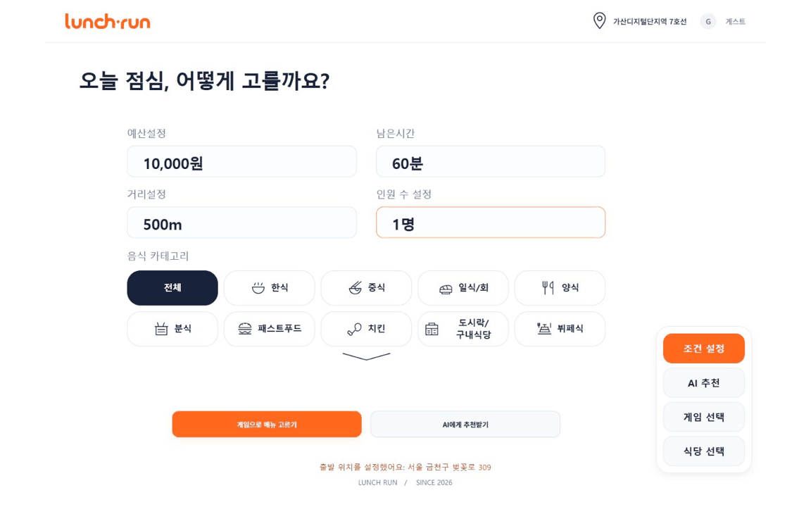
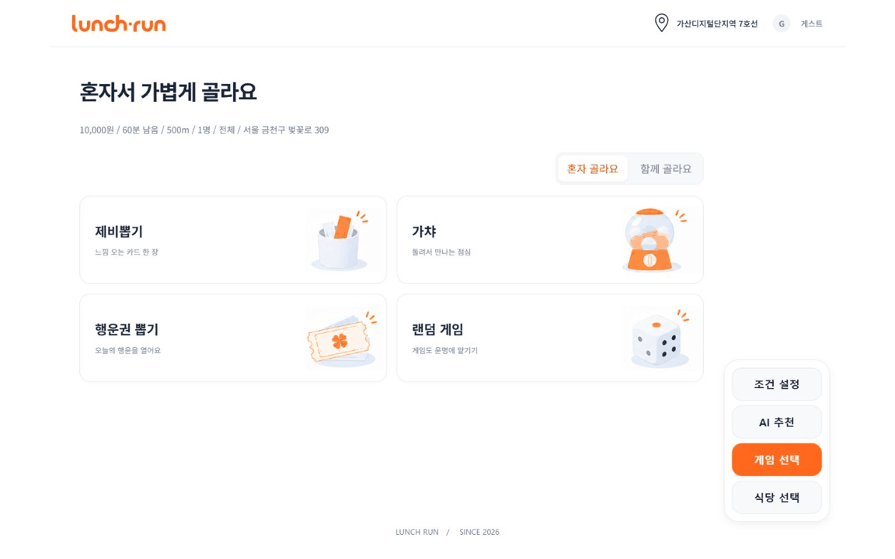
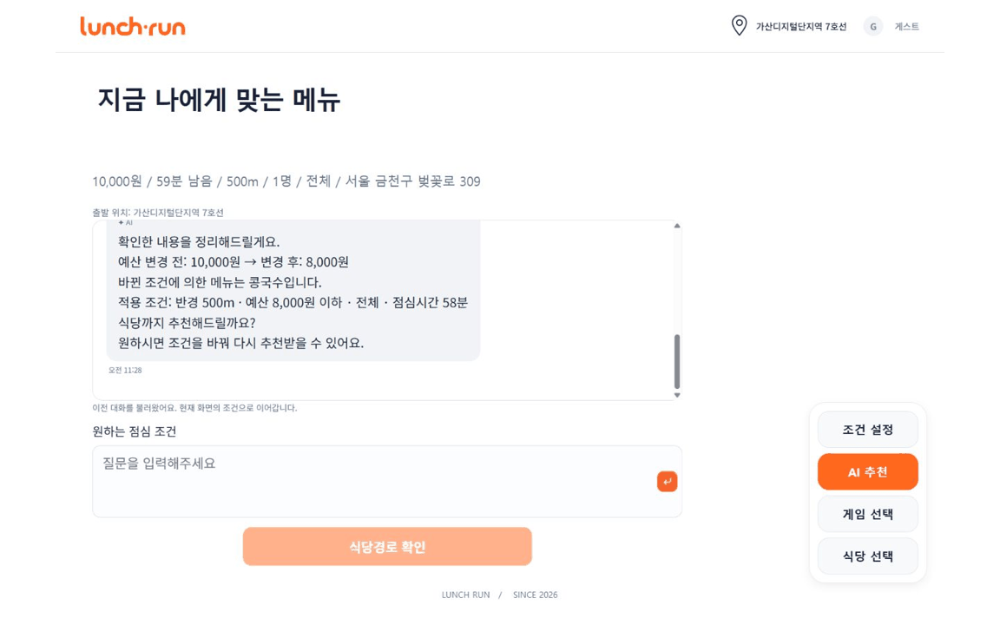
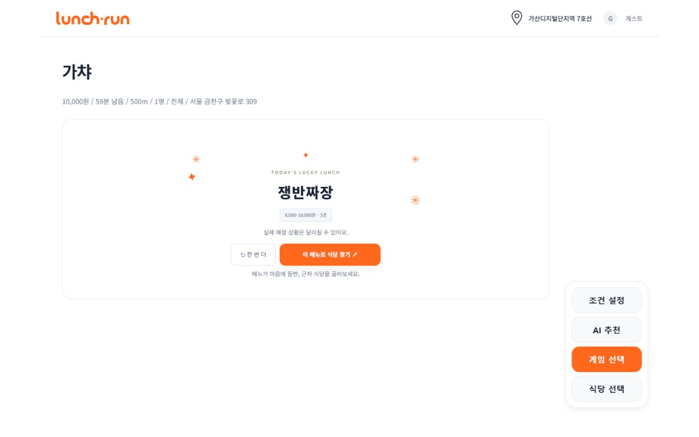
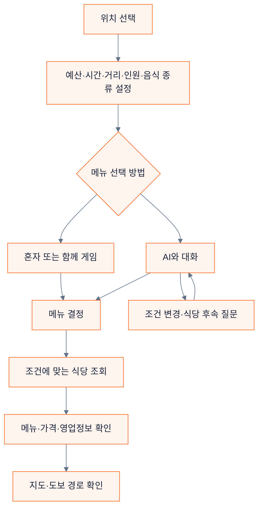
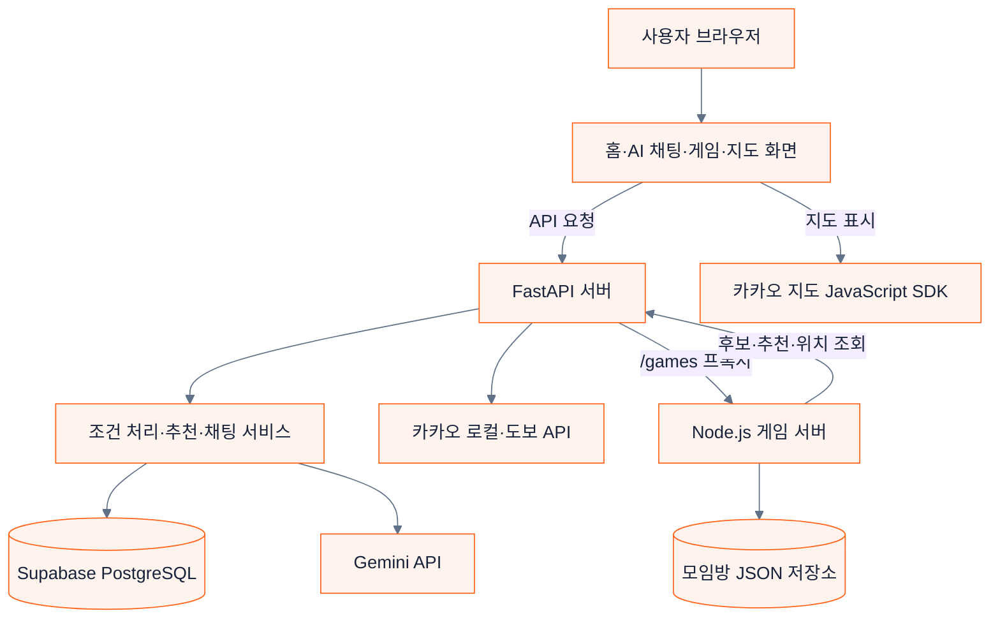

<p align="center">
  
</p>

<h1 align="center">점심 메뉴부터 식당까지, LUNCHRUN</h1>

<p align="center">
  점심 메뉴를 정하지 못하는 당신에게,<br />
  메뉴와 식당까지 한번에 추천드립니다!
</p>

<p align="center">
  <a href="#프로젝트-소개">프로젝트 소개</a> ·
  <a href="#주요-기능">주요 기능</a> ·
  <a href="#시스템-아키텍처">시스템 아키텍처</a> ·
  <a href="#실행-방법">실행 방법</a> ·
  <a href="#관련-문서">관련 문서</a>
</p>

> **프로젝트: LUNCHRUN · 개발 기간: 2026.11.12–11.16**  
> [서비스 바로가기](https://lunchrun.onrender.com) · [GitHub 저장소](https://github.com/encore-ai-campus/aio-04-p1-team4)

---

## 목차

1. [프로젝트 소개](#프로젝트-소개)
2. [팀 정보](#팀-정보)
3. [기획 배경](#기획-배경)
4. [주요 기능](#주요-기능)
5. [서비스 이용 흐름](#서비스-이용-흐름)
6. [기술 스택](#기술-스택)
7. [시스템 아키텍처](#시스템-아키텍처)
8. [프로젝트 구성과 코드 흐름](#프로젝트-구성과-코드-흐름)
9. [AI 처리와 데이터 구조](#ai-처리와-데이터-구조)
10. [실행 방법](#실행-방법)
11. [관련 문서](#관련-문서)

---

## 프로젝트 소개

<p align="center">
  
</p>

**LUNCHRUN**은 매일 점심 메뉴를 고민하는 직장인을 위한 메뉴·식당 추천 서비스입니다. 사용자는 현재 위치와 원하는 음식 조건을 입력하고, 게임이나 AI 챗봇을 통해 메뉴와 식당을 추천받습니다.

추천된 식당 중 원하는 곳을 선택하면 현재 위치에서 식당까지의 도보 경로와 예상 이동시간을 확인할 수 있습니다. 추천 결과가 마음에 들지 않으면 언제든 조건을 바꾸고 새로운 메뉴와 식당을 추천받을 수 있습니다.

| 서비스 영역 | 제공 기능 |
|:---:|:---:|
| 조건 설정 | 현재 위치·주소·장소 선택, 예산·남은 시간·거리·인원·음식 종류 설정 |
| 메뉴 결정 | 혼자 또는 함께하는 메뉴 게임, 모임방에서 공통 메뉴 선택 |
| AI 대화 | 메뉴·식당 추천, 자연어 조건 변경, 식당 가격·주소·영업시간 후속 질문 |
| 식당·지도 | 조건에 맞는 식당 조회, 메뉴·영업정보 확인, 도보 경로 조회 |

## 팀 정보

| 항목 | 내용 |
|:---:|:---:|
| 팀명 | LUNCHRUN |
| 개발 기간 | 2026년 11월 12일~16일 |

| 이름 | 담당 영역 |
|:---:|:---:|
| 김형준 | 백엔드 서버 구축 및 AI 챗봇 기능 구현 |
| 김지훈 | 프론트엔드 구축 및 UI 구현 |
| 김지우 | DB 구축 및 지도 기능 구현 |
| 조현서 | 아이디어 기획 및 게임 기능 구현 |

## 기획 배경

매일 반복되는 점심시간에도 메뉴와 식당을 고르는 일은 고민으로 남습니다. LUNCHRUN은 직장인이 자신의 위치와 식사 조건에 맞춰 메뉴를 정하고, 실제로 방문할 식당과 이동 경로까지 한 흐름에서 확인할 수 있도록 기획했습니다.

혼자 또는 동료와 메뉴를 고를 때는 게임을 이용하고, 원하는 조건을 말로 전달하고 싶을 때는 AI 챗봇을 이용합니다. 메뉴를 정한 뒤 다시 식당과 길을 찾아야 하는 과정을 줄이고, 조건을 바꿔 다른 후보도 살펴볼 수 있도록 구성했습니다.

## 주요 기능

### 위치와 식사 조건 설정

<p align="center">
  
</p>

현재 위치를 사용하거나 주소·장소를 검색해 출발점을 정합니다. 예산, 남은 식사 시간, 거리, 인원과 음식 종류를 설정하고 메뉴 선택으로 이동합니다.

추천 API의 반경은 50m부터 500m까지, 예산은 1,000원부터 100,000원까지 설정할 수 있습니다. 남은 시간은 추천 조건으로 전달되며, 실제 이동·식사 완료 시간을 보장하는 값은 아닙니다.

### 게임으로 메뉴 고르기

<p align="center">
  
</p>

- **혼자 고르기:** 제비뽑기, 가챠, 행운권 뽑기, 랜덤게임으로 메뉴를 결정합니다.
- **함께 고르기:** 룰렛과 사다리 게임을 이용합니다.
- **우리의 교집합:** 모임방을 만들고 QR·초대 링크·방 코드로 참여합니다. 각자 선택한 메뉴의 교집합을 구하고, 공통 후보가 없으면 최다 선택 후보로 재투표합니다.

모임방은 최대 12명이 참여할 수 있으며 24시간 후 만료됩니다. 최종 메뉴를 정하면 식당 찾기로 이어집니다.

### AI와 대화하며 조건 바꾸기

<p align="center">
  
</p>

메뉴나 식당을 추천받고, 같은 대화에서 예산·반경·음식 종류를 바꿀 수 있습니다. 앞서 표시된 식당을 기준으로 가격·주소·영업정보도 질문할 수 있습니다.

| 질문 예시 | 처리 내용 |
|:---:|:---:|
| 어떤 메뉴가 있어? | 조건에 맞는 메뉴 후보 안내 |
| 메뉴 추천해줘 | 후보 중 메뉴 선정 |
| 이 메뉴 파는 식당 알려줘 | 선택한 메뉴를 판매하는 식당 조회 |
| 첫 번째 식당 가격은? | 앞서 표시한 식당 상품의 가격 안내 |
| 예산을 8천원으로 바꿔줘 | 예산 변경 후 결과 갱신 |

### 식당 조회와 지도

<p align="center">
  
</p>

조건에 맞는 식당을 최대 3곳까지 보여줍니다. 영업이 확인된 식당을 우선하고, 같은 그룹 안에서는 거리가 가까운 순서로 정렬합니다. 휴무·폐업·영업시간 외·예산 초과가 확인된 항목은 제외합니다. 가격이나 시간이 확인되지 않은 경우에는 안내 문구를 함께 표시합니다.

식당 상세에서는 저장된 메뉴·가격·영업시간을 확인할 수 있습니다. 지도는 식당 위치와 도보 경로를 표시하며, 목록의 직선거리와 실제 도보 경로의 이동거리를 구분합니다.

시연 위치는 가산디지털단지역입니다. 추천 결과는 조회 시점의 조건과 영업정보에 따라 달라집니다.

## 서비스 이용 흐름



여럿이 선택할 때는 모임방을 생성하고 참여자가 각자 메뉴를 고릅니다. 공통 후보 또는 재투표 결과로 최종 메뉴를 정한 뒤 식당을 조회합니다.

## 기술 스택

| 영역 | 기술 | 사용 목적 |
|:---:|:---:|:---:|
| Frontend | HTML, CSS, JavaScript | 조건 설정, AI 채팅, 게임·지도 화면 |
| Backend | Python, FastAPI, Uvicorn | API 제공, 정적 화면 제공, 게임 서버 프록시 |
| 요청 검증 | Pydantic | 요청 모델과 값 범위 검증 |
| 게임 서버 | Node.js, JavaScript ES Modules | 게임 자원 제공, 모임방·참여자·투표 상태 처리 |
| Database | Supabase (PostgreSQL) | 식당·메뉴·영업시간 저장과 조회 |
| DB 접근·변경 관리 | SQLAlchemy, psycopg, Alembic | ORM·SQL 실행, PostgreSQL 연결, 스키마 마이그레이션 |
| AI | Google Gemini API | 질문 의도 해석, 답변의 추가 설명 구성 |
| 위치·지도 | 카카오 지도 JavaScript SDK, 카카오 로컬 API, 도보 길찾기 API | 위치 검색, 지도 표시, 경로 조회 |
| 외부 통신·설정 | httpx, python-dotenv | 서버의 외부 API 호출, 환경변수 로딩 |
| 테스트 | Pytest, Node.js 테스트 러너, Playwright | API·추천 로직·화면 상태·브라우저 흐름 테스트 |

## 시스템 아키텍처



FastAPI는 메인 화면과 API를 제공하며, `/games` 요청을 Node 게임 서버로 전달합니다. 게임 서버도 메뉴 후보와 식당 추천에는 공통 FastAPI를 사용합니다. 카카오 REST 키와 Gemini 키는 서버에서 관리하고, 브라우저 지도에는 별도의 JavaScript 키를 사용합니다.

현재 소스의 게임 프록시는 `games/app.py`의 `NODE_ORIGIN`에 지정된 `https://lunchrun-games.onrender.com`으로 연결됩니다. 로컬 Node 서버를 실행해도 이 연결 대상은 자동으로 바뀌지 않습니다.

## 프로젝트 구성과 코드 흐름

```text
LUNCHRUN/
├── app/               # FastAPI·추천·AI 채팅·DB 접근
├── frontend/          # 홈·조건 설정·채팅 화면과 공통 상태
├── games/             # Node.js 게임·모임방
├── kakao-map/         # 식당·지도·도보 경로 화면
├── alembic/           # DB 마이그레이션
├── data/              # 데이터 파일
├── tests/             # API·로직·화면 테스트
├── docs/              # 설계·관리·운영 문서
├── requirements.txt   # Python 의존성
└── run.ps1            # Windows 서버 실행
```

### 채팅 요청이 처리되는 순서

| 단계 | 주요 코드 | 역할 |
|:---:|:---:|:---:|
| 1. 화면 상태 관리 | `frontend/state.js`, `frontend/chat.js` | 위치·조건 공유, 요청 전송, 응답 표시 |
| 2. 요청 수신·검증 | `app/main.py`, `app/api.py`, `app/schemas.py` | 라우팅, 입력 검증, 세션 식별 |
| 3. 질문 해석 | `app/clients/gemini.py`, `app/chat_policy.py` | 질문을 추천·조건 변경·상세 조회 등으로 해석 |
| 4. 실제 처리 | `app/services.py`, `app/db_recommendations.py` | 조건 적용, DB 후보 조회·선정 |
| 5. 답변 구성 | `app/answer_narration.py` | 서버가 정한 결과를 바탕으로 추가 설명 구성·검증 |
| 6. 결과 전달 | `app/api.py`, `app/chat_sessions.py` | JSON·NDJSON 응답과 최근 대화 저장 |

일반 메뉴·식당 조회는 질문 해석 없이 요청 조건으로 DB를 조회합니다. 게임의 조건을 백엔드 요청으로 변환하는 코드는 `games/dist/backend.mjs`에 있습니다.

## AI 처리와 데이터 구조

### AI와 서버의 역할

AI는 자연어 질문을 해석하고 답변의 추가 설명을 구성합니다. 메뉴·가격·식당 선택과 조건 적용은 서버가 저장된 데이터를 기준으로 처리합니다.

```text
사용자 질문 + 현재 위치·조건 + 최근 대화
                    ↓
           Gemini 질문 의도 해석
                    ↓
        서버가 조건 변경·DB 조회·결과 확정
                    ↓
       서버 사실 문장 + Gemini 추가 설명 구성
                    ↓
          결과 검증·응답·대화 상태 저장
```

추가 설명 생성만 실패하면 서버가 확보한 결과를 유지해 답변합니다. 질문 자체를 해석하지 못한 경우에는 오류로 처리합니다. 채팅 스트림은 처리 단계별 NDJSON 이벤트와 최종 결과를 전달합니다.

### 대표 메뉴와 식당 상품의 연결

| 데이터 | 역할 |
|:---:|:---:|
| `menu_catalog` | 추천·게임에서 선택할 대표 메뉴 |
| `menu` | 식당에서 판매하는 실제 상품과 가격 |
| `restaurant` | 식당 식별자, 주소·좌표 등 기본 정보 |
| `business_hours` | 요일별 영업시간과 휴무 정보 |

대표 메뉴는 `menu.menu_catalog_id`로 실제 식당 상품과 연결됩니다. 카탈로그에 메뉴 이름만 추가해도 해당 지역의 추천 후보가 생기는 것은 아닙니다. 추천에는 위치·반경·음식 종류·상품 가격·영업 상태 등의 조건을 적용합니다.

일반 추천은 저장된 DB를 조회하며 식당을 새로 수집하지 않습니다. DB에 연결된 상품이 없거나 조건에 맞지 않으면 후보가 없을 수 있습니다.

### 상태 저장

| 상태 | 저장 위치 |
|:---:|:---:|
| 식당·메뉴·영업정보 | Supabase PostgreSQL |
| 최근 대화 10턴·표시 식당 정보 | FastAPI 프로세스 메모리, 쿠키로 세션 식별 |
| 브라우저의 위치·조건·참여 상태 | `sessionStorage` |
| 모임방·투표 결과 | 게임 서버의 JSON 파일 |

로그인 인증과 Redis 기반 상태 공유는 현재 구현 범위에 포함되지 않습니다. 채팅 기록은 서버 재시작이나 세션 만료 시 삭제됩니다. 채식·맵기·인분·품절 여부는 추천 필터로 사용하지 않습니다.

## 실행 방법

### 1. 개발 환경 준비

Python 3.12 이상을 준비합니다. 게임 서버를 로컬에서 실행하려면 Node.js도 필요합니다. 아래 명령은 저장소 루트의 PowerShell에서 실행합니다.

```powershell
python -m venv .venv
.\.venv\Scripts\python.exe -m pip install -r requirements.txt
```

### 2. 환경변수 설정

`.env.example`을 참고해 저장소 루트에 `.env`를 작성합니다.

| 변수 | 용도 |
|:---:|:---:|
| `MAP_API_KEY` | 카카오 REST 키. 서버 시작 시 필수 |
| `KAKAO_JAVASCRIPT_KEY` | 브라우저 지도 SDK용 키 |
| `GEMINI_API_KEY` | AI 대화용 Gemini 키 |
| `GEMINI_MODEL` | 사용할 모델 ID. 기본값은 `.env.example`과 `app/config.py` 참조 |
| `GEMINI_NARRATION_ENABLED` | 추가 설명 생성 사용 여부 |
| `DATABASE_URL` 또는 `SUPABASE_DB_URL` | Supabase PostgreSQL 연결 주소 |
| `COOKIE_SECURE` | 로컬 HTTP에서는 `false`, HTTPS에서는 `true` |

키와 비밀번호가 들어 있는 `.env`는 공유하지 않습니다. 현재 DB는 Supabase PostgreSQL을 사용합니다. 연결 주소는 `DATABASE_URL` 또는 `SUPABASE_DB_URL`로 설정하며, 둘 다 설정하면 `DATABASE_URL`을 우선합니다. 실행 환경에 설정된 환경변수가 `.env`보다 우선하므로 변경 시 함께 확인합니다.

서버 시작 전 `Lunchrun` 스키마와 Alembic revision `0004_csv_import_records`가 준비되어 있어야 합니다. 서버는 PostgreSQL의 revision을 검사하며, 실행만으로 스키마나 식당 데이터를 새로 구성하지 않습니다. 새 DB의 스키마·데이터 준비는 [DB 마이그레이션 안내](docs/database_migration_guide_v1.md)와 [메뉴 관리 가이드](docs/seed_management_v2.md)를 따릅니다.

### 3. FastAPI 실행

```powershell
.\run.ps1
```

또는 다음 명령으로 실행합니다.

```powershell
.\.venv\Scripts\python.exe -m uvicorn app.main:app --host 127.0.0.1 --port 8000
```

| 접속 주소 | 용도 |
|:---:|:---:|
| `http://127.0.0.1:8000/` | 홈·조건 설정 |
| `http://127.0.0.1:8000/ai` | AI 채팅 |
| `http://127.0.0.1:8000/games/` | 게임 화면 |
| `http://127.0.0.1:8000/map/` | 식당·지도 |
| `http://127.0.0.1:8000/docs` | Swagger API 문서 |
| `http://127.0.0.1:8000/api/health` | HTTP 서버 응답 확인 |
| `http://127.0.0.1:8000/api/readiness` | DB·메뉴·필수 설정 준비 상태 |
| `http://127.0.0.1:8000/api/gemini/status` | Gemini API 키·모델 접근 상태 확인 |

위치 검색·지도·도보 경로를 이용하려면 카카오 앱의 API 사용 설정과 키를 준비합니다. JavaScript 키에는 접속 도메인을 등록하고, 도보 API의 사용 권한을 확인합니다. `gemini/status`는 모델 접근 상태를 확인하며 실제 답변 생성 성공 여부는 별도로 확인해야 합니다.

### 4. 로컬 게임 서버 실행

별도 PowerShell 터미널에서 저장소 루트를 기준으로 실행합니다.

```powershell
$env:HOST = '127.0.0.1'
$env:PORT = '4174'
$env:BACKEND_ORIGIN = 'http://127.0.0.1:8000'
$env:PYTHON_BIN = (Resolve-Path '.\.venv\Scripts\python.exe').Path
node .\games\server.mjs
```

로컬 게임 서버 주소는 `http://127.0.0.1:4174`입니다. 메인 서버의 `/games`에서 로컬 변경 사항을 확인하려면 `games/app.py`의 `NODE_ORIGIN`도 로컬 주소로 맞춰야 합니다. 지도는 FastAPI의 `/map/`에서 제공하므로 별도 지도 서버를 실행하지 않습니다.

### 5. 테스트

추천 조건·후속 질문·화면 상태를 점검하는 테스트 예시입니다.

```powershell
.\.venv\Scripts\python.exe -m pytest tests/test_chat_conditions_stage4.py tests/test_chat_followups_stage3.py tests/test_recommendation_policy_stage1.py -q
node --test tests/chat-conditions-stage4.test.cjs tests/chat-session-ui.test.cjs tests/shared-state.test.cjs
```

브라우저 테스트는 Playwright 실행 환경이 필요합니다. 외부 API 키·DB·네트워크가 필요한 테스트는 해당 설정을 준비한 뒤 실행합니다.

채팅 연동을 점검할 때는 `/api/chat/stream`의 최종 `completed.data`와 `failed` 이벤트를 확인합니다. 스트림이 시작된 뒤에는 HTTP 200이어도 `failed` 이벤트로 오류가 전달될 수 있습니다. 응답·이벤트별 상세 형식은 [API 설계서](docs/API_DESIGN_v1.md)를 참고합니다.

## 관련 문서

| 문서 | 내용 |
|:---:|:---:|
| [문서 목록](docs/README.md) | 설계·운영 자료 안내 |
| [API 설계서](docs/API_DESIGN_v1.md) | 요청·응답 모델, 엔드포인트, 오류 처리 |
| [DB 설계서](docs/DB_DESIGN_v1.md) | 테이블·관계·키·제약과 저장 구조 |
| [코드 구조·수정 가이드](docs/CURRENT_GUIDE_v1.md) | 주요 파일 역할과 기능별 수정 위치 |
| [메뉴 관리 가이드](docs/seed_management_v2.md) | 대표 메뉴와 실제 상품 연결·관리 |
| [음식 종류 매핑](docs/food_conditions_v3.md) | 음식 분류 기준 |
| [DB 마이그레이션 안내](docs/database_migration_guide_v1.md) | DB 스키마 적용 절차 |
| [운영 점검표](docs/operations_checklist_v1.md) | 설정·준비 상태·장애 점검 |

---

<p align="center">
  <br />
  <sub>LUNCH RUN / SINCE 2026</sub>
</p>
