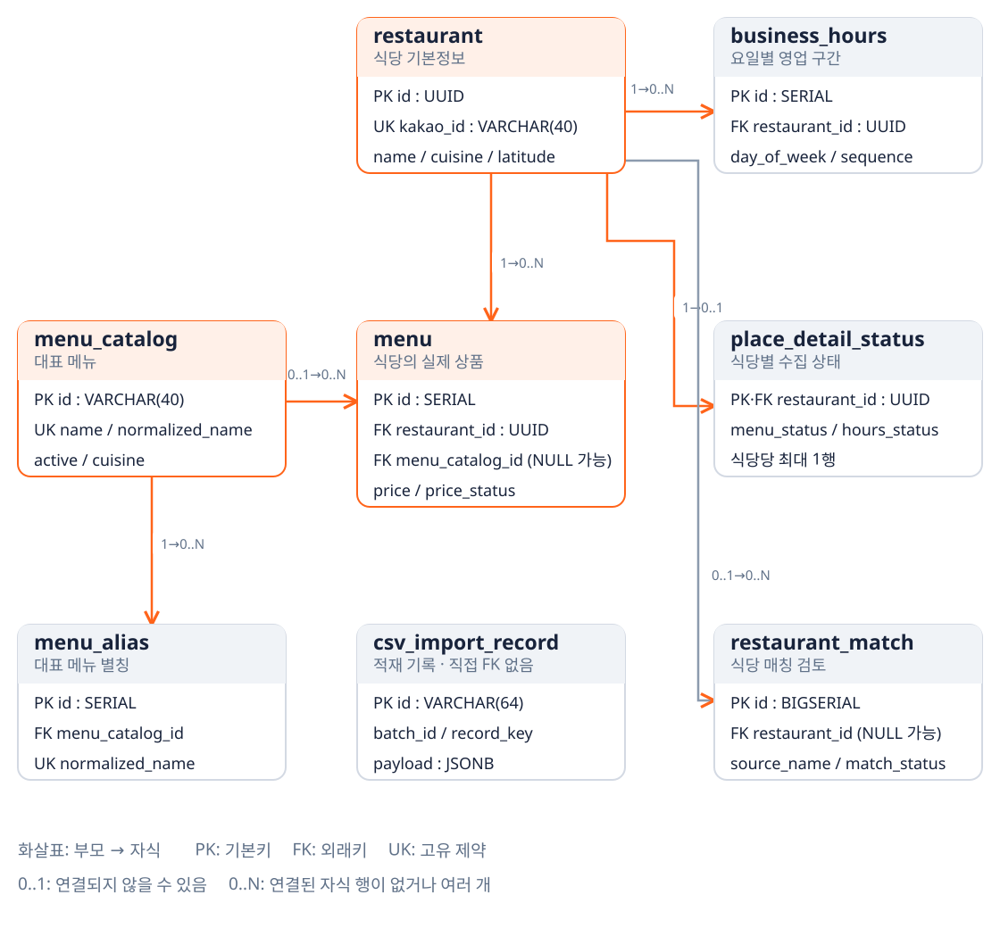

# LUNCHRUN DB 설계서

| 항목 | 내용 |
| :---: | :---: |
| 기준일 | 2026-11-16 |
| DBMS | Supabase PostgreSQL |
| 업무 스키마 | `Lunchrun` |
| ORM / 변경 관리 | SQLAlchemy / Alembic |
| 기준 마이그레이션 | `0004_csv_import_records` |
| PDF | [DB 설계서](DB설계서_LUNCHRUN.pdf) |

## 1. 테이블 관계

식당의 실제 상품을 대표 메뉴에 연결해 추천에 사용한다. 아래 도식은 주요 키와 외래키를 나타내며, 전체 컬럼은 테이블 상세에서 확인할 수 있다.

`csv_import_record`의 JSONB 내부 식당 ID에는 FK 검사가 적용되지 않는다. `alembic_version`은 Alembic이 관리하는 별도 메타데이터 테이블이다.

## 2. 설계 범위

식당·실제 상품·대표 메뉴·영업시간과 수집·매칭·적재 기록을 관리한다. 일반 추천은 저장된 DB를 조회하고, CSV 적재와 상세정보 수집은 별도 관리 작업으로 수행한다.

| 테이블 | 역할 |
| :---: | :---: |
| restaurant | 식당 식별자·위치·주소·운영 상태 |
| menu | 식당별 실제 상품·가격·판매 상태 |
| menu_catalog / menu_alias | 대표 메뉴와 별칭 |
| business_hours / place_detail_status | 요일별 영업시간과 수집 상태 |
| restaurant_match | 원본 식당과 카카오 장소 매칭 검토 |
| csv_import_record | 적재·정제·분류 감사 기록 |
| alembic_version | 스키마 변경 버전 |

DBMS는 Supabase PostgreSQL, 업무 스키마는 대소문자를 구분하는 `"Lunchrun"`이다. PK는 기본키, FK는 외래키, UK는 고유 제약이다. 표의 필수는 NOT NULL, 선택은 NULL 허용을 뜻한다. 운영 DB의 실제 행 수·권한 상태는 별도 점검 대상이다.

### 관계와 삭제 정책

| 부모 → 자식 | 관계 | 부모 삭제 시 |
| :---: | :---: | :---: |
| restaurant → menu | 1 : 0..N | CASCADE |
| restaurant → business_hours | 1 : 0..N | CASCADE |
| restaurant → place_detail_status | 1 : 0..1 | CASCADE |
| restaurant → restaurant_match | 0..1 : 0..N | 식당 FK를 SET NULL |
| menu_catalog → menu | 0..1 : 0..N | 대표 메뉴 FK를 SET NULL |
| menu_catalog → menu_alias | 1 : 0..N | CASCADE |

## 3. 식당과 실제 상품

### restaurant · 식당

| 컬럼 | 자료형 | 조건 | 설명 |
| :---: | :---: | :---: | :---: |
| id | UUID | PK·필수 | 내부 식당 ID |
| kakao_id | VARCHAR(40) | UK·선택 | 카카오 장소 ID |
| naver_id | VARCHAR(40) | 선택 | 네이버 장소 ID |
| name | VARCHAR(200) | 필수 | 식당명 |
| category_name | VARCHAR(300) | 선택 | 원본 업종 분류 |
| cuisine | VARCHAR(30) | 선택 | 검색용 음식 분류 |
| latitude / longitude | FLOAT | 필수 | 위도 / 경도 |
| address | VARCHAR(500) | 필수 | 주소 |
| place_url | VARCHAR(1000) | 선택 | 장소 상세 URL |
| operating_status | VARCHAR(20) | 필수 | 운영 상태 |
| updated_at | TIMESTAMPTZ | 필수 | 갱신 시각 |

내부 `id`는 UUID이며 `kakao_id`·`naver_id`와 구분한다. `kakao_id`는 값이 있을 때 중복을 허용하지 않는다. 위도는 -90부터 90, 경도는 -180부터 180까지 허용한다.

### menu · 실제 상품

| 컬럼 | 자료형 | 조건 | 설명 |
| :---: | :---: | :---: | :---: |
| id | SERIAL | PK·필수 | 자동 생성 상품 ID |
| restaurant_id | UUID | FK·필수 | 판매 식당 |
| menu_catalog_id | VARCHAR(40) | FK·선택 | 연결된 대표 메뉴 |
| name / normalized_name | VARCHAR(200) | 필수 | 상품명 / 정규화명 |
| price | INTEGER | 선택 | 매장 표시 가격 |
| price_status | VARCHAR(20) | 필수 | 가격 확인 상태 |
| availability_status | VARCHAR(20) | 필수 | 판매 상태 |
| source_provider | VARCHAR(40) | 선택 | 정보 제공처 |
| source_url | VARCHAR(1000) | 선택 | 정보 출처 URL |
| verified_at | TIMESTAMPTZ | 선택 | 확인 시각 |

`(restaurant_id, normalized_name)` 조합은 고유하다. `price_status=known`이면 가격은 양의 정수이며, `missing`·`variable`이면 NULL이다. `availability_status`는 저장하지만 현재 추천에서 품절 필터로 사용하지 않는다.

## 4. 대표 메뉴와 별칭

### menu_catalog · 대표 메뉴

| 컬럼 | 자료형 | 조건 | 설명 |
| :---: | :---: | :---: | :---: |
| id | VARCHAR(40) | PK·필수 | 대표 메뉴 ID |
| name | VARCHAR(100) | UK·필수 | 대표 메뉴명 |
| normalized_name | VARCHAR(100) | UK·필수 | 정규화명 |
| cuisine | VARCHAR(20) | 필수 | 음식 종류 |
| search_keyword | VARCHAR(100) | 필수 | 기존 검색 필드 |
| description | VARCHAR(500) | 필수 | 설명 |
| price_hint | INTEGER | 선택 | 기존 참고 가격 |
| active | BOOLEAN | 필수 | 활성 여부 |
| created_at / updated_at | TIMESTAMPTZ | 필수 | 생성 / 갱신 시각 |

### menu_alias · 대표 메뉴 별칭

| 컬럼 | 자료형 | 조건 | 설명 |
| :---: | :---: | :---: | :---: |
| id | SERIAL | PK·필수 | 자동 생성 별칭 ID |
| menu_catalog_id | VARCHAR(40) | FK·필수 | 대표 메뉴 |
| name | VARCHAR(100) | 필수 | 별칭 |
| normalized_name | VARCHAR(100) | UK·필수 | 정규화한 별칭 |

정규화한 별칭은 전체에서 고유하며, 별칭의 대표 메뉴 연결은 필수다. 실제 상품은 `menu.menu_catalog_id`로 대표 메뉴에 연결한다. `price_hint`는 NULL 또는 0 이상만 허용하지만 현재 예산 판정에는 사용하지 않는다.

`cuisine`은 한식, 중식, 일식/회, 양식, 분식, 패스트푸드, 치킨, 도시락/구내식당, 뷔페식, 냉면, 고기, 카페/빵, 술집, 기타의 14개 값으로 제한한다. 검색 옵션인 ‘전체’는 저장하지 않는다.

## 5. 영업시간과 수집 상태

### business_hours · 요일별 영업 구간

| 컬럼 | 자료형 | 조건 | 설명 |
| :---: | :---: | :---: | :---: |
| id | SERIAL | PK·필수 | 영업 구간 ID |
| restaurant_id | UUID | FK·필수 | 식당 |
| day_of_week | INTEGER | 필수 | 월요일 0~일요일 6 |
| holiday | BOOLEAN | 선택 | 휴무 여부 |
| start_time / end_time | TIME | 선택 | 시작 / 종료 시각 |
| ends_next_day | BOOLEAN | 필수 | 다음 날 종료 여부 |
| last_order_time | TIME | 선택 | 주문 마감 시각 |
| sequence | INTEGER | 필수 | 구간 순번 |
| source_url | VARCHAR(1000) | 선택 | 시간표 출처 |
| verified_at | TIMESTAMPTZ | 선택 | 확인 시각 |

`(restaurant_id, day_of_week, sequence)`는 고유하며 `sequence`는 0 이상이다. 시작·종료 시각은 함께 존재하거나 함께 NULL이어야 한다. `holiday=true`이면 두 시각은 NULL이며, 휴무 여부 NULL은 미확인을 뜻한다.

브레이크 타임 전후는 같은 요일의 별도 행으로 저장한다. 자정을 넘겨 끝나면 `ends_next_day=true`로 표시한다. TIME은 시간대 없는 시각이며, 영업 판정 시 한국 시간으로 해석한다. `last_order_time`은 현재 추천의 별도 마감 필터로 적용하지 않는다.

### place_detail_status · 식당별 수집 상태

| 컬럼 | 자료형 | 조건 | 설명 |
| :---: | :---: | :---: | :---: |
| restaurant_id | UUID | PK·FK·필수 | 식당별 최대 한 행 |
| menu_status / hours_status | VARCHAR(20) | 필수 | 메뉴 / 시간표 상태 |
| last_attempt_at | TIMESTAMPTZ | 선택 | 최근 시도 시각 |
| last_success_at | TIMESTAMPTZ | 선택 | 기존 성공 시각 |
| menu_last_success_at | TIMESTAMPTZ | 선택 | 메뉴 최근 성공 |
| hours_last_success_at | TIMESTAMPTZ | 선택 | 시간표 최근 성공 |
| error_code | VARCHAR(50) | 선택 | 내부 오류 코드 |

수집 상태와 실제 영업 상태는 구분한다. 일반 추천은 `menu_status`·`hours_status`의 성공 여부를 필수 조건으로 검사하지 않는다. 채팅에서 식당의 메뉴 목록을 묻는 후속 질문은 `menu_status=success`와 저장 메뉴 존재 여부를 확인한다.

## 6. 매칭과 적재 기록

### restaurant_match · 식당 매칭 검토

| 컬럼 | 자료형 | 조건 | 설명 |
| :---: | :---: | :---: | :---: |
| id | BIGSERIAL | PK·필수 | 매칭 검토 ID |
| restaurant_id | UUID | FK·선택 | 확정된 내부 식당 |
| source_name | VARCHAR(200) | 필수 | 원본 식당명 |
| source_address | VARCHAR(500) | 필수 | 원본 주소 |
| candidate_kakao_id | VARCHAR(40) | 선택 | 카카오 후보 ID |
| match_status | VARCHAR(20) | 필수 | 매칭 상태 |
| reason | VARCHAR(500) | 선택 | 판단 근거 |
| reviewed_at | TIMESTAMPTZ | 선택 | 검토 시각 |

`candidate_kakao_id`는 외부 후보 식별자이며 FK가 아니다. 확정 식당이 삭제되면 검토 기록은 보존하고 `restaurant_id`만 NULL로 변경한다.

### csv_import_record · 적재 감사 기록

| 컬럼 | 자료형 | 조건 | 설명 |
| :---: | :---: | :---: | :---: |
| id | VARCHAR(64) | PK·필수 | 기록 ID |
| batch_id | VARCHAR(64) | 필수 | 적재 배치 ID |
| record_kind | VARCHAR(40) | 필수 | 기록 유형 |
| record_key | TEXT | 필수 | 대상 식별 문자열 |
| payload | JSONB | 필수 | 원본·분류·검토 정보 |

ORM 모델이 아닌 `0004_csv_import_records` 마이그레이션에 정의한다. `record_key`에는 UNIQUE 제약이 없으며, 직접 FK나 별도 보조 인덱스도 정의하지 않는다. 배치·원본·분류·연결 판단은 `payload`에 보존한다. 추천 시에는 DB의 검토 메타데이터를 읽으며 CSV 파일을 매번 읽지는 않는다.

### 상태값

| 대상 | 허용값 |
| :---: | :---: |
| 가격 | known / missing / variable |
| 판매 | available / sold_out / unknown |
| 운영 | operating / closed / unknown |
| 메뉴·시간표 수집 | pending / success / missing / fetch_failed / parse_failed |
| 식당 매칭 | matched / review / not_found |

## 7. 조회 기준과 접근 관리

### 추천 데이터 판정

| 항목 | 현재 처리 |
| :---: | :---: |
| 상품 연결 | 활성 대표 메뉴에 FK로 연결된 실제 상품을 사용한다. 적재 메타데이터의 catalog_status가 linked가 아니면 제외한다. |
| 위치·음식 종류 | 출발점과의 직선거리로 반경을 검사하며, 음식 종류는 식당의 cuisine 또는 category_name을 기준으로 판정한다. |
| 가격 | 확인 가격이 예산을 초과하면 제외한다. 가격 NULL은 허용하고 가격 확인 불가 안내를 표시한다. |
| 영업 상태 | 한국 시간으로 계산한다. 확인된 폐업·휴무·영업시간 외는 제외하고, 시간표 미확인은 안내와 함께 허용한다. |
| 품절·인분 | 품절·인분 상태를 추천 필터로 사용하지 않으며, 이에 따른 별도 미확인 안내도 생성하지 않는다. |
| 결과 정렬 | 식당당 상품 1개를 표시한다. 가격 확인 상품을 우선 선택하고, 영업 확인 식당 우선·각 그룹 거리순으로 최대 3곳을 반환한다. |

경고 문구는 가격·영업시간·휴무 미확인에 대해 생성한다. 후보가 없어도 가상 식당이나 `price_hint`로 결과를 보충하지 않는다.

### 주요 인덱스

| 테이블 | 인덱스 컬럼 |
| :---: | :---: |
| restaurant | (latitude, longitude) / cuisine |
| menu | (normalized_name, price) / (menu_catalog_id, price) |
| menu_catalog | (active, cuisine, price_hint) |
| menu_alias | menu_catalog_id |
| business_hours | (restaurant_id, day_of_week) |
| restaurant_match | match_status |

PK·UK에 따른 인덱스는 위 목록과 별개다. `updated_at`의 자동 갱신은 ORM의 `onupdate` 설정이며, 외부 SQL 갱신에도 적용되는 DB 트리거가 정의된 것은 아니다. 식당 UUID도 ORM에서 생성하며 직접 SQL로 적재할 때는 ID를 제공해야 한다.

### 접근·트랜잭션·스키마 변경

브라우저는 FastAPI를 통해 조회하며 DB 접속 비밀값을 받지 않는다. FastAPI의 DB 의존성에서 여는 PostgreSQL 세션은 `SET TRANSACTION READ ONLY`로 시작한다. 연결 체크아웃 시 `search_path`를 `"Lunchrun"`으로 지정한다.

`0003`·`0004` 마이그레이션은 업무·검토 테이블 8개에 RLS를 활성화하고 `anon`·`authenticated`의 테이블 권한을 회수하도록 정의한다. 실제 배포 DB의 적용 여부와 관리자 역할의 RLS 우회 가능성은 별도 확인해야 한다.

PostgreSQL 앱 시작 시 `alembic_version`이 `0004_csv_import_records`인지 검사하며, 자동 테이블 생성·시드 적재는 수행하지 않는다. `0003`은 데이터가 있는 업무 테이블의 재구성을 거부하고, `0003`·`0004`의 자동 downgrade도 차단한다. 되돌리기는 별도 역마이그레이션으로 처리한다.

## 8. 기준 코드

컬럼·키·제약은 현재 로컬 코드와 고정 DDL을 기준으로 정리했다. 운영 DB의 실제 데이터 수량·성능·권한 적용 결과를 나타내는 문서는 아니다.

| 파일 | 확인 대상 |
| :---: | :---: |
| app/database/models.py | ORM 컬럼·관계·제약·인덱스 |
| alembic/versions/0003_db_first_schema.py | PostgreSQL 업무 테이블 DDL·RLS |
| alembic/versions/0004_csv_import_records.py | 적재 기록 테이블·RLS |
| app/database/session.py | 읽기 전용 요청 세션·search_path·revision 검사 |
| app/db_recommendations.py | 실제 추천 조건·정렬·미확인 안내 |
| app/services.py | 채팅 후속 질문 처리 |
| app/food_types.py | 음식 종류와 원본 업태 매핑 |

저장소: [encore-ai-campus/aio-04-p1-team4](https://github.com/encore-ai-campus/aio-04-p1-team4)
