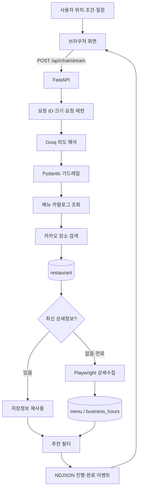

# LunchRun 통합 아키텍처 v1

- 작성일: 2026-11-10
- 범위: 1~7단계 통합 구조

## 전체 흐름

## 책임 분리

| 구성요소 | 책임 |
|---|---|
| Groq | 질문 의도, 메뉴·식당 대상, 조건 변경안 해석 |
| FastAPI | 검증, 실행 순서, 스트리밍, 오류 경계 |
| SQLAlchemy | SQLite/PostgreSQL 공통 ORM과 세션 |
| Alembic | 스키마 버전 이력과 업그레이드 |
| 카카오 장소 API | 위치 주변 음식점 기본정보 검색 |
| Playwright | 카카오 상세페이지 메뉴·가격·영업시간 수집 |
| 추천 엔진 | 메뉴 판매, 가격, 한국 시간 영업 여부 판정 |
| 메모리 세션 | 최근 10턴, 선택 메뉴, 최근 식당, 확인 대기 |
| 메모리 요청 제한 | 단일 프로세스 세션별 과다 요청 차단 |

## 데이터 신뢰 경계

- Groq가 가격·주소·영업 여부를 생성하지 않는다.
- 식당 기본정보는 카카오 API 결과만 저장한다.
- 메뉴·가격·영업시간은 상세페이지에서 확인한 값만 저장한다.
- `price_hint`는 메뉴 후보 필터용이며 실제 매장 가격으로 출력하지 않는다.
- 현재 영업 상태는 테이블에 저장하지 않고 요청 시 한국 시간으로 계산한다.
- 누락값은 `0`이나 임의 사실로 바꾸지 않는다.

## 운영 경계

현재 구조는 SQLite와 단일 FastAPI 프로세스 기준이다. PostgreSQL/Supabase는 SQLAlchemy와 Alembic 연결 URL로 전환할 수 있다. 다중 서버의 세션·요청 제한·수집 작업 복구는 Redis 구현이 필요하다.
